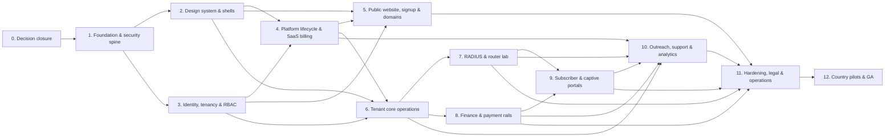

# MylesNet End-to-End Implementation Plan

**Status:** Planning handoff; product implementation has not been authorized or started. The repository foundation exists. 
**Scope:** Complete v1 from requirements closure through controlled country launches and general availability. 
**Decision baseline:** Approved decisions in `READINESS-DECISIONS.md` and the project charter in `../AGENTS.md` take precedence over older proposal/open wording elsewhere. 
**Planning date:** 11 November 2026.

This is a sequence and acceptance plan, not a schedule or a claim that the services/providers/legal approvals already exist. Work proceeds only after the user explicitly moves the project into implementation. Do not create product code, connect live providers or routers, provision production infrastructure, or deploy as part of this planning document.

## 1. Executive delivery model

MylesNet is a multi-tenant ISP operations SaaS serving Kenya, Uganda, and Tanzania. V1 covers public marketing and signup, platform administration, tenant operations, subscriber account portal, captive portal, and the separately operated RADIUS/network data plane. The initial release supports single-branch operators while preserving multi-branch, multi-country, and multiple legal entities from day one.

Deliver in gated increments. Each phase produces reviewable requirements, code/configuration only after authorization, operational evidence, and an explicit exit decision. Foundation and shared security boundaries precede broad CRUD. Network and payment paths are prototyped in isolated labs/sandboxes before end-to-end activation is enabled. Public launch is country-gated; legal/provider approval in one country does not enable the others.

### Delivery principles

1. **Resolve requirements before implementation.** Keep approved decisions, proposals, and unresolved gates clearly labeled. Do not infer exact prices, quotas, legal terms, retention periods, provider contracts, or SLOs that are still open.
2. **Establish isolation first.** Tenant and branch context is resolved on trusted server boundaries. Every query, mutation, action, subscription, file, export, job, callback, cache, and search path is scoped and tested.
3. **Keep authoritative systems explicit.** Convex owns SaaS application state and realtime projections. WorkOS owns staff authentication. FreeRADIUS plus PostgreSQL owns time-critical AAA behavior. Payment providers own payment evidence; immutable ledgers record financial effects. No dual-write without an outbox/idempotency contract.
4. **Use adapters and country capability gates.** Country, legal entity, currency, provider, rail, and approval state determine what is available. Unsupported or unapproved paths remain disabled with visible explanation.
5. **Ship vertical slices with operational completion.** A feature is not done when its screen renders. It needs authorization, audit, failure/retry behavior, observability, accessibility, support instructions, and recovery behavior.
6. **Preserve reference evidence without copying live data.** The private product screenshots guide layout and observed workflows. They are not test fixtures, token sources, or authorization to reproduce personal records.

## 2. Product outcomes and measurable targets

The 12-month planning outcomes are 1,000 active paying ISP tenants and 100,000 active subscriber accounts. The subscriber number is a scenario derived from an average of 100 accounts per tenant, not a market forecast. Confirm a capacity and commercial model before using these as funded commitments.

| Outcome | Approved planning target | Measurement / qualification |
|---|---:|---|
| Active paying ISP tenants | 1,000 at month 12 | Define active and paying states; count distinct tenants at month end. |
| Active subscriber accounts | 100,000 at month 12 | Distinct, non-test accounts with a valid active service entitlement; exclude expired, suspended, duplicate, and test accounts. |
| Eligible subscriber login success | At least 99.5% monthly | Separate infrastructure failures from credential, account-state, and policy denials; count eligible attempts consistently. |
| Managed RADIUS availability | 99.95% monthly | About 22 minutes in a 30-day month; define probe locations, maintenance treatment, and dependency attribution. |
| Hosted captive portal availability | 99.95% monthly | Measure portal availability separately from payment providers and subscriber uplink faults. |
| Confirmed payment to access activation | At least 99% within 30 seconds | Clock begins when MylesNet receives a valid confirmation; report provider delay separately. |
| Confirmed payment record/reconciliation | At least 99% within one minute | Unmatched cases enter a visible exception queue immediately while safe retries continue. |

Review the scorecard monthly and reassess assumptions quarterly. The product, platform, network, payments, and support owners define exact event sources, exclusions, dashboards, and alert thresholds during Phase 0/1.

## 3. Current foundation and implementation boundaries

The repository contains a setup-only pnpm/Turborepo foundation, planning documents, and reserved application/backend boundaries. The scaffold is not product implementation evidence. Existing private references and local configuration must remain private; never print or commit secret values.

### Approved direction to carry forward

- Workspace: pnpm workspaces and Turborepo; Node.js/pnpm versions are setup-time pins and must be revalidated at kickoff.
- Apps: `apps/web` for public and subscriber surfaces; `apps/admin` for authenticated platform and tenant operator surfaces; `apps/storybook` for design-system documentation and review.
- Backend: Convex for application state, transactional mutations, scheduled work, and realtime projections; it is not on the RADIUS request path.
- Identity: WorkOS AuthKit for staff sign-in, invitations, and identity workflows; map each WorkOS organization to an internal tenant. App-side authorization owns tenant/branch roles and lifecycle state.
- Design: user-approved MylesNet Design System v1.0 and its central DTCG source; shared UI and generated semantic tokens are the only product UI source. The supplied reference images guide layout and flow rather than brand tokens.
- Network: FreeRADIUS 3.2.x plus dedicated PostgreSQL AAA store, redundant MylesNet-managed regional service; MikroTik RouterOS 7 first-class with WireGuard enrollment restricted to RADIUS and CoA/Disconnect.
- Payments: provider adapters; initial candidates Daraja (Kenya), iOtec (Uganda), ClickPesa (Tanzania), Selcom backup in Tanzania; selection and activation remain subject to contract, sandbox, legal, settlement, and payout validation.
- Hosting: Vercel Dublin (`dub1`) and Convex Europe (Ireland) are leading candidates, not approved live residency or deployment facts.
- Communications: WorkOS default sender for identity emails; Resend candidate for MylesNet application mail, SES Ireland fallback if transfer review disallows Resend. Compare Africa's Talking and Infobip for SMS; Twilio is a price benchmark.

### Explicit service boundaries

| Component | Authoritative responsibility | Must not become |
|---|---|---|
| WorkOS | Staff identity/session/authentication and organization membership identity | The only authorization check or source of branch permissions. |
| Convex | Tenant/business application state, workflows, realtime UI projections, schedule coordination | RADIUS packet processor, secret store, or second financial authority without ledger/event contracts. |
| FreeRADIUS + PostgreSQL AAA | Low-latency subscriber authentication/accounting and durable network event intake | Browser-facing application backend or a source of unreviewed financial facts. |
| Payment providers | Rail execution and provider-confirmed evidence | MylesNet ledger or authorization policy. |
| MylesNet ledgers | Immutable record of accepted financial effects and adjustments | Mutable UI totals derived only from the client. |
| RouterOS worker/provisioner | Narrow, auditable router enrollment and allowed network control actions | Remote WinBox, SSH, or RouterOS API access. |
| Email/SMS adapters | Delivery attempt/status and provider abstraction | Storing unnecessary message bodies, credentials, or authorization logic. |

The chosen app split is the current charter direction. Before product work, record ADRs for shared login/session behavior across `apps/web` and `apps/admin`, host/domain routing, and public/subscriber versus staff trust boundaries. Do not silently consolidate or split apps during implementation.

## 4. Phase map and critical dependencies

Phases can overlap only when interfaces are approved and their prerequisites are satisfied. The critical path is requirements and threat model → tenant/security spine → tenant and platform foundations → public signup and tenant operations → independent RADIUS/payment proofs → portal activation → country readiness → controlled launch. No calendar estimate is assigned because team size, budget, provider access, and implementation start date are not set.

## 5. Phase plans

### Phase 0 — Close planning and turn decisions into build contracts

**Purpose:** make all approved decisions usable by product, design, engineering, security, finance, network, and operations without reviving stale “open” entries.

**Work items**

1. Establish a decision register with ID, source, decision status (approved / candidate / open / rejected), owner, evidence, dependency, and revisit trigger. READINESS decisions and the project charter take precedence over older proposal text.
2. Reconcile stale lines in canonical docs and annotate previous alternatives rather than erasing useful history. In particular, resolve old claims about whether multi-branch is in v1, whether RADIUS outage behavior is open, whether SSO/SCIM is in scope, whether subscription providers are shared with subscriber collection accounts, and whether plans gate white-label/domain access.
3. Approve an ADR set before implementation: application split/session topology; WorkOS organization mapping; Convex tenant/branch authorization and realtime revocation; data/region strategy; RADIUS source of truth and outbox; payment ledger, pooled-vs-direct merchant model and country gates; domains/DNS/TLS/callback transition; theme compiler and theme schema; storage/exports/backups; deployment/rollback; observability and SLO measurement. See the [Phase 0 ADR index and contracts](adr/README.md).
4. Produce a complete story and acceptance catalog for all surface routes and actions. Use stable requirement IDs; map each route to roles, branch scope, CRUD/action verbs, plan/tenant lifecycle state, data classes, reference capture, and acceptance cases. See the [Phase 0 requirement and route/action traceability catalog](REQUIREMENT-ROUTE-TRACEABILITY.md).
5. Freeze v1 scope and exclusions. Capture unresolved commercial values (tier names/prices/limits), legal terms, precise retention periods, provider contracts/sandbox readiness, DNS registrar, SMS/email selection, accountant adapters, scale budgets, RPO/RTO, support staffing, and CMS/editorial workflow.
6. Define cross-country country pack requirements for Kenya, Uganda, and Tanzania: legal entity/currency/tax/invoice, payment collection/payout capability, SMS sender/delivery, language, timezone, data transfers, retention, support, and launch approval evidence.
7. Define threat model and data classification. Identify secrets, credentials, PII, financial records, payment tokens, router/NAS metadata, AAA records, audit/support access, and screenshot/reference data. See the [data ownership and classification map](DATA-OWNERSHIP-AND-CLASSIFICATION.md), [threat model](THREAT-MODEL.md), [API/error/event contract backlog](API-ERROR-EVENT-CONTRACT-BACKLOG.md), and [synthetic-data/environment rules](SYNTHETIC-DATA-AND-TEST-ENVIRONMENTS.md).
8. Set engineering working agreements: branch/PR/check/review policy, dependency update cadence, local synthetic data, environment separation, feature flags, security review, accessibility gates, release owner, incident commander, and rollback authority.

**Deliverables:** reconciled canonical docs; ADRs; requirement/route/action/role/entitlement matrix; data dictionary and ownership map; event/API contract backlog; threat model; country launch checklist; prioritized v1 story map; operational assumptions and named owners.

**Exit gate:** no material contradiction on product scope, service boundaries, role ownership, currency/money rules, or network outage behavior; unresolved vendor/legal/cost values have explicit owners and do not block safe development environments. User approves moving from planning to implementation.

### Phase 1 — Workspace, environments, and security spine

**Purpose:** create a reproducible local/CI foundation without connecting local development to production.

**Work items**

1. Verify supported Node/pnpm/Next/React/Convex/WorkOS compatibility and security advisories; pin versions and document upgrade policy.
2. Establish workspace scripts, Turbo task graph, shared TypeScript/lint conventions, formatting, CI checks, local bootstrap, and safe `.env.example`. Add no real keys or production URLs.
3. Define environment topology: local synthetic; shared development; isolated integration/sandbox; staging/preproduction; production. Separate Convex deployments, WorkOS apps, OAuth callbacks, provider credentials, domains, queues, and secrets by environment.
4. Establish secret management and rotation process. Add least-privilege secret references for WorkOS, email/SMS, payment, domain/TLS, RADIUS/worker, storage, and observability. Secret values are never returned to the UI or logs.
5. Add dependency and supply-chain controls, secure headers, CSP strategy, CSRF/session protections where applicable, rate limiting, input validation, safe error conventions, and audit event envelope.
6. Define correlation IDs and structured redacted telemetry from browser/server to Convex action/job/provider boundary; document PII scrub rules.
7. Create architecture skeletons for `apps/web`, `apps/admin`, `apps/storybook`, central `packages/design-system`, shared config/tooling, and root `convex/` only after authorization. No feature code before security context patterns are agreed.
8. Confirm no dependency from RADIUS authentication/accounting to Convex synchronous availability.

**Deliverables:** environment matrix and access map; CI workflow; dependency/security policy; secret inventory/rotation runbook; telemetry schema; local synthetic-data generator; architecture boundary diagrams.

**Exit gate:** clean local bootstrap and CI on a clean checkout; each environment points only to its intended services; secret scanning and dependency checks are in place; cross-boundary data flow and logging policy reviewed. (These are future acceptance criteria; no tests/builds are run for this planning task.)

### Phase 2 — Design-system source closure and shared shells

**Purpose:** implement one maintainable, tenant-safe design foundation before building all application screens.

**Work items**

1. Close the v1.0 audit gaps: replace example schema IDs; decide supported optional secondary-accent behavior; reconcile shape-preset “proposed” labels; complete missing common dark resolved tokens; define contrast and chart-color checks; verify package outputs; source approved logo/font binaries and licenses.
2. Decide central package ownership and generated-output rules. DTCG source is canonical; raw token source is not imported by apps. Build generated CSS variables/Tailwind mappings and typed theme APIs; never hand-edit generated output or scatter token literals.
3. Implement semantic tokens for color, type, spacing, sizing, layout, border, elevation, focus, motion, charts, and status. Define Light/Dark/System, Comfortable/Compact, platform brand versus tenant theme, reduced motion, forced colors, and device-driven touch sizing.
4. Implement shared components with documented states: buttons, links, fields, selects, dialogs, menus, tables, pagination, filters, cards, badges, alerts, empty/loading/error states, toasts, date/currency inputs, charts, skeletons, and accessible navigation.
5. Build shared shells: public/identity; platform; tenant operations; tenant settings rail; subscriber account; captive portal; document/email/PDF template layer. Keep audience-specific navigation and data boundaries while preserving visual consistency.
6. Implement tenant theme input validation and safe compile/publish/preview/rollback. Permit only approved inputs (logo/assets, primary color, approved font, approved shape preset, density default, portal image, constrained email content); lock status/focus semantics, layout, type scale, and arbitrary CSS.
7. Implement theme propagation across tenant console, captive/account portal, email, invoice, PDF, and generated voucher outputs with preview and version tags. Custom domains remain separate from visual branding.
8. Add Storybook galleries for Light/Dark/System, densities, tenant-brand extremes, locales, responsive sizes, and keyboard/screen-reader/component states. Establish visual regression and accessibility review process.

**Deliverables:** finalized design contract; central token package; shared UI package; all audience shells; theme compiler/schema; Storybook visual catalog; asset/license register; design governance and deprecation policy.

**Exit gate:** all surfaces resolve tokens through the same package; zero unapproved theme inputs; screenshot comparison and accessibility/contrast gates pass; no missing generated semantic values; one theme change does not break emails/PDF/captive/marketing.

### Phase 3 — Identity, tenant hierarchy, RBAC, audit, and lifecycle

**Purpose:** build authorization and tenant boundaries before feature CRUD.

**Work items**

1. Define internal IDs and data ownership: platform, tenant, branch, legal entity, staff identity, subscriber identity, NAS, portal domain, and provider account. Tenant may have many branches and legal entities across countries; branches have country, currency, timezone, and optional entity association; no branch/entity plan cap.
2. Map WorkOS organization to internal tenant. Resolve trusted active organization and tenant from signed session and verified membership. Never authorize from client-provided tenant/branch IDs.
3. Define centralized authorization evaluator: principal, tenant, branch, permission, resource, lifecycle, entitlement, and support-grant context. Apply it on queries, mutations, actions, subscriptions, exports, file URLs, jobs, search, and callbacks.
4. Implement platform roles (Owner, Operations, Finance, Support, Security Admin, Auditor) with mandatory MFA. Implement tenant roles (exactly one Owner, Admin, Finance, Network Operator, Support Agent, Sales/Agent, Analyst/Read-only) and independent custom roles.
5. Implement role management: Owner fixed; Owner may edit other built-in permission bundles; custom roles can be created or cloned independently; built-ins cannot be deleted; assigned custom role deletion is blocked; admins cannot delegate beyond their own ceiling; high-risk grants require Owner.
6. Support one tenant-wide assignment plus scoped branch role assignments; one role per assignment scope. Tenant-wide applies all branches; branch assignments add rights only in those branches. Subscriber identities are separate from staff RBAC.
7. Implement invitations: Owner/Admin may invite; Admin within own ceiling; high-risk approvals before send; no Owner via ordinary invite; single-use, 7-day expiry. Deactivation/access removal immediately revokes membership and active sessions, ends live subscriptions, and clears tenant client state. Permission changes recompute access immediately while keeping sign-in session.
8. Implement exactly-one-Owner invariant and transfer: outgoing Owner MFA-confirms; incoming Owner verifies/accepts/MFA; atomic transfer; incoming chooses former Owner scope (tenant-wide Admin default, narrower role, or remove); notify verified tenant contacts; recovery path if outgoing Owner unavailable.
9. Implement account recovery: verified self-service first; manual support requires business status, claimant authority/identity, trusted-contact callback, 24-hour default / 72-hour high-risk delay; high-risk requires independent Security Admin approval and enhanced evidence; notify only prior verified contacts and support dispute flow.
10. Implement tenant lifecycle state machine and provisioning job framework with idempotent retries, bounded failure path, support correlation, trial, active, past-due, grace, restricted, suspended, cancellation, export, retention, legal hold, and deletion states.
11. Implement immutable audit record schema, actor/delegator, reason, before/after references (redacted), tenant/branch, request/correlation, timestamp, source, and retention classification.
12. Implement platform support grants: tenant Owner approves scoped grants up to one hour; read-only by default; explicitly listed reversible contact/profile corrections and support notes may be granted; emergency grants require two distinct platform approvals and stay read-only. Notify tenant at start; banner, immutable read/write audit, expiry/revoke, no self-approval.

**Deliverables:** identity/tenant model; RBAC/permission catalog; lifecycle state machine; audit taxonomy; access review workflows; recovery/ownership transfer; support grant workflow; adversarial access test plan.

**Exit gate:** automated negative access checks prove cross-tenant and cross-branch denials across direct calls and live subscriptions; owner uniqueness/transfer atomicity holds; immediate revocation behavior works; support access cannot exceed its grant; audit evidence exists for privileged operations.

### Phase 4 — Platform control plane and MylesNet subscription lifecycle

**Purpose:** operate tenants, plans, and the SaaS subscription independently of ISP customer collections.

**Platform modules**

- Health overview: tenant counts/state, onboarding/provisioning failures, job/queue health, service incidents, payment status, integration health, usage summaries with minimized subscriber PII.
- Tenant directory/details: search, lifecycle, country/entities/branches, owner and verified contacts, domains, plan, usage, onboarding timeline, suspend/reactivate, cancellation/offboarding/export status, reason-confirmed destructive actions.
- Plan catalog: three monthly tiers, identical feature set with subscriber/router quotas scaled. Exact names, prices, included limits, currency tables, tax presentation, and change policy remain commercial decisions. No branch/legal entity caps; custom domain is included in every tier.
- Subscription billing: 14-day trial from email verification without payment method; require billing setup and tenant confirmation before first charge; 7-day completion grace at trial end; tier upgrades immediate after Owner confirmation and prorated difference payment; downgrades next renewal; quota reached retains existing data/services and blocks new records while explaining upgrade.
- Subscription invoice payment: selected billing legal entity and its exact currency; MylesNet-owned merchant accounts separate from tenant collection accounts. Daraja/iOtec/ClickPesa/Selcom are candidates subject to validation. Manual Pay for mobile money/bank/card; provider fees absorbed in plan price. Invoice reminders 7/3/1 days before due; stop once paid.
- Optional wallet auto-pay for eligible MylesNet-managed collection tenants only: Owner MFA-step-up controls; off by default; selected billing entity wallet and exact invoice currency only; first attempt one day before due; retry hourly while short, including during suspension; completed payment restores service; disabling cancels future attempts immediately.
- Monthly and annual renewal; annual 15% discount; auto-renew unless Owner cancels before next renewal; cancellation mid annual term has no prorated refund and service continues to paid-through date. First successful paid invoice anchors billing; missing day uses last day of cycle then returns to anchor date.
- Support access, operator roles/MFA, tenant domain health, integration status without exposing secrets, audit/policy, and platform controls.

**Deliverables:** platform route catalog and shell; tenant lifecycle console; versioned plan/entitlement service; invoice and payment ledger; subscription dunning/recovery; usage counters; operator and audit views.

**Exit gate:** subscription invoices and tenant collections are separate ledgers/accounts; entitlements are server-evaluated; trial, upgrade/downgrade, limits, suspension/recovery, reminders, auto-pay and cancellation scenarios reconcile without double charge; no unapproved pooled payout is enabled.

### Phase 5 — Public website, signup, account onboarding, and domains

**Purpose:** deliver all 308 public routes and safe tenant acquisition without compromising dynamic identity or tenant data.

**Public content work**

1. Import all 308 public sitemap URLs as structured route/content records. The 307 non-homepage paths comprise 36 feature pages, 33 blog index/article paths, 177 changelog paths, 4 solution paths, 4 comparison paths, 1 integrations directory, and 52 other paths; count the homepage separately as URL 308. The screenshot manifest also includes UI captures beyond sitemap pages. Preserve intended canonical paths, metadata, redirects, internal links, and sitemap membership.
2. Render mostly static/server-rendered content for SEO, accessibility, and global CDN caching. Add a CMS only after editorial ownership, roles, preview, approval, versioning, scheduled publishing, redirect, and rollback requirements are decided. Marketing publication cannot mutate tenant operations.
3. Rebuild navigation, search/discovery, pricing, consent/cookie behavior where required, calculators/tools, legal pages, changelog/blog listing and detail pages, responsive layouts and accessible menus.
4. Reconcile all route slugs against `docs/reference-images/public-site-screenshots/route-manifest.csv`. Treat screenshots as private; no credentials/PII/sample tenant values in content.

**Signup/onboarding**

1. Collect email and verify before tenant provisioning; allow phone later. Throttle verification and prevent account/subdomain enumeration.
2. Enforce one owned tenant per verified identity; permit same company name for a different identity when subdomain is unique. Do not collect government registration ID in v1.
3. Collect company display name, requested MylesNet subdomain, country, referral source, terms/consent, and applicable billing entity/currency decisions. Launch countries Kenya, Uganda, Tanzania; language defaults English with Kiswahili switch support.
4. Create WorkOS org/internal tenant/Owner/default roles/settings/branch/legal entity and trial idempotently. Show truthful provisioning progress, retry state, correlation/support path. Do not declare ready until Owner can enter.
5. Keep subdomain stable by default; verified rename preserves old address as tenant redirect alias and never reassigns it.

**Domain lifecycle**

- Default MylesNet subdomain; custom portal domain on all tiers. Domain flow follows reference: show tenant domain and generated DNS A-record instructions; verify explicitly; issue TLS automatically; surface pending/active/failure and safe retry.
- Maintain previous callback/portal addresses until tenant confirms migration and explicitly stops serving them. Never silently break callbacks. Define wildcard DNS strategy, DNS ownership verification, rate limits, certificate renewal, domain takeover prevention, registrar link and support flow in ADR/runbook.
- “Buy a domain” opens an approved external registrar; tenant returns to the DNS setup workflow.

**Deliverables:** route/content registry and all pages; signup and recoverable provisioning; domain management and TLS; SEO/canonical/redirect inventory; country-aware localization plan.

**Exit gate:** 308 manifest URLs resolve to approved page content/redirect; signup duplicate/provisioning failure cases are idempotent; tenants cannot claim each other’s host; certificate and callback migration safely tested; legal content approved per country before launch.

### Phase 6 — Tenant console foundation and operational CRUD

**Purpose:** deliver the core ISP operations surface as secure vertical slices, with full CRUD where the underlying record lifecycle allows it.

**Shell and workspace context**

- Tenant grouped navigation (Overview, Customers, Network, Finance, Outreach, Insights), nested Finance/Communications, settings rail, global search, support/profile actions, branch selector, tenant switcher, locale/theme controls, billing/plan state banners and responsive/collapsed navigation.
- All routes show loading, empty, error, stale/offline, denied, read-only, plan-disabled, over-quota, suspended and success states as applicable.
- Branch and legal entity filters are explicit; every list, report, export, create form, job, and detail route preserves selected scope. No branch scope is inferred from hidden UI state.

**Feature delivery order and record behavior**

1. **Subscribers:** list/search/detail/create/update/archive, service entitlements, contact/consent, import preview/validation/rollback, scoped export; account identity deduplication; secrets masked and reveal permission-gated.
2. **Leads:** CRUD, assignment/stages, import/export, conversion with history and dedupe.
3. **Support tickets:** CRUD/status/priority/assignment/comments/resolve/reopen, analytics, scoped import/export, subscriber own-ticket view.
4. **Plans/packages:** create/read/update/archive shared templates; branch-local price/currency/availability; compose speed, quota, validity/time, session limits and fair-use policy. Preserve historical purchase/price terms.
5. **Live sessions:** real-time view, filters, branch/router/subscriber details; disconnect/reconnect as audited privileged jobs; session history derived from AAA authority.
6. **Router/NAS registry:** register/read/update/archive, capabilities, site assignment, enrollment status, health, RADIUS status, generated setup wizard, credential references, controlled service config. Never expose router administration console through the service tunnel.
7. **Network map, CPE/firmware, equipment, fiber map:** CRUD and relationships, import where applicable, state history, firmware approval and rollout policy. Confirm whether TR-069/ACS is v1 or later before implementing remote management.
8. **Finance basics:** payments, invoices, expenses, credits, loyalty and reports. Draft data is editable; settled/posted data is immutable and changed through reversals, credit notes or adjustment records.
9. **Vouchers and sales:** templates/batches/agents, issue, reserve, assign, sell, print/export, redeem, void, commission snapshot and reconciliation. Generation requires secure entropy and uniqueness; issued codes are not editable into a different entitlement.
10. **Staff/roles/audits:** use Phase 3 services; expose filtered, branch-scoped views and safe role editing; audit logs are read-only.
11. **Tenant settings:** branding, domain, PPPoE, hotspot, payment rails, SMS/email/WhatsApp, templates, loyalty, notifications, AI provider/key reference, accounting integrations, developer/API/webhooks, profile, security, retention, country/legal entity, timezone/currency, branch and tenant subscription. Each setting group has its own permission, validation, audit, and secret rotation rules.
12. **Tenant subscription:** plan/usage/invoices/payment and owner-only auto-pay controls, separate from subscriber payment ledger.

**Deliverables:** complete shell; route groups; route/action permission matrix; domain CRUD slices; import/export framework; search/filter/table/form patterns; branch-safe notifications; tenant setup checklist.

**Exit gate:** all 73 captured tenant route/view entries map to an implemented, explicitly deferred, or replaced requirement with rationale; route links and CRUD actions are permission gated; branch/tenant scope works through direct URLs and exports; financial/audit history cannot be erased.

### Phase 7 — Network access, RADIUS, MikroTik, and policy enforcement

**Purpose:** prove reliable network service independently before activating customer purchases.

**RADIUS and AAA**

1. Build redundant regional FreeRADIUS 3.2.x endpoints and a dedicated PostgreSQL AAA store with backup, replication/HA, capacity, local durability and access controls.
2. Define tenant/NAS identity binding, shared-secret lifecycle, credential derivation, policy resolution, rate limits, packet validation, replay protection and tenant mismatch rejection.
3. Support Hotspot and PPPoE. Service plan rules include speed, quota, validity/time, session/device limits, burst options, allowed days/time schedule, NAS restrictions, and configurable FUP.
4. Persist Accounting Start/Interim/Stop idempotently, recover active-session projection, reconcile missing Stop/duplicate/out-of-order events, and relay to Convex through durable outbox with retries/backpressure.
5. Implement policy sync and versioned cache invalidation. Existing sessions remain active during RADIUS reachability failure; reject new logins until recovery (fail closed). For expired package, deny new login and disconnect active sessions immediately.
6. For quota exhaustion, let each tenant configure per package: throttle or disconnect/block and send a notice; reset per purchase/daily/weekly/monthly. Tenant policy is explicit, testable, and visible to support. Do not assume default quota action.
7. Add CoA/Disconnect with signed/authorized commands, idempotency, retry/timeout, result and audit trace.

**MikroTik setup**

- RouterOS 7 compatibility checks. Each router must complete router-initiated WireGuard provisioning using a short-lived, single-use enrollment token/script delivered in the setup wizard.
- Tunnel scope only RADIUS auth/accounting and CoA/Disconnect; firewall policy blocks WinBox, SSH and RouterOS API. Rotate/revoke tunnel and RADIUS credentials; script output contains no long-lived reusable secret.
- Show wizard states: identity, provisioning, services, done; script copied/run state; device mode advisory; last-seen/config version/errors; safe regenerate/revoke and audit.
- Synthetic RouterOS test lab covers versions/models, malformed config, NAT/MTU, interrupted setup, lost token, key rotation, revoked tenant, bandwidth and reconnect behavior.

**Deliverables:** network architecture/DR runbook; AAA schema/policies; RouterOS setup wizard; session projections; RADIUS CoA workflow; lab compatibility matrix; security review.

**Exit gate:** target 99.95% measured in representative failover tests; eligible login success definition reaches target in load/chaos trials; no fail-open; accounting survives relay outage and drains without duplicates; router tunnel cannot reach admin surfaces; active session disconnect behavior is verified.

### Phase 8 — Tenant financial ledger, collections, payouts, invoices, and reconciliation

**Purpose:** build money handling with explicit country/currency/entity boundaries and provider-independent domain contracts.

**Core accounting model**

1. Define currency-safe integer minor units or approved currency-aware decimal rules, ledger account types, posting invariants, event IDs, idempotency keys, reversals, fees, settlement, refunds, chargebacks, reconciliation states and audit evidence.
2. Separate: tenant subscriber collections; tenant wallet/liabilities; payout requests; platform SaaS subscription collections; manual payments; expenses/invoices; and provider settlement records. Do not commingle MylesNet subscription funds and tenant pooled collections.
3. Per transaction, store country, legal entity, branch where applicable, original currency/amount, provider, merchant-account mode, fee breakdown, timestamps, source and status. No cross-entity wallet movement or silent FX conversion.
4. Reports show separate branch/entity currency totals and optionally consolidated conversion from latest official central-bank reference rates, always with source, rate, and as-of time.

**Collections and payment workflows**

- Ask each tenant during onboarding to use direct-to-tenant merchant account or MylesNet-managed pooled collection. Both models are designed, but pooled collections/payout enabled only per country after legal/provider approval.
- Adapter contracts for Daraja Kenya, iOtec Uganda, ClickPesa Tanzania; validate Selcom as Tanzania backup. Sandbox test signatures, callbacks, retries, settlement, refunds, fees, reversals, phone formats, rate limits, provider outages and exact-once ledger effect.
- Confirmed callback processing: signature/replay/schema validation; merchant→tenant/entity/branch resolution; dedupe; amount/currency match; append financial event; update entitlement once; show success/pending/error; immediate unmatched exception and safe background retries.
- Manual cash/bank/mobile-money payment: one authorized staff member may record, credit and activate immediately; require reference/reason and audit; preserve source and evidence; reconciliation queue flags duplicates and missing references.
- Full/partial refunds in MylesNet where gateway supports; otherwise visible provider/manual exception. Tenant config selects second approval: always, above threshold, or none. Full refund of active plan cancels entitlement and disconnects; partial refund leaves access intact and records a financial adjustment.

**Withdrawals and wallets**

- Country/rail-specific configurable MylesNet fee (fixed, percent, or both) plus provider fee; show Requested, MylesNet fee, provider fee, Recipient receives before confirmation. Rates/limits remain operational/commercial decisions.
- Withdrawals up to available balance (no platform minimum/maximum/daily cap per current decision); user must hold dedicated branch-scoped withdrawal permission or be Owner. Every request requires code to Owner’s verified email; step-up MFA for sensitive actions applies.
- Use saved verified destination per legal entity. Owner approves additions/changes. Include recipient, phone, rail, currency, entity, fees, amount, OTP expiry/attempt limits, status, timestamps, provider reference.
- Provider-confirmed failed withdrawal automatically restores principal to available balance; keep failed record. Retry only as new request. Reconcile uncertain/pending provider results before release.
- Instant payout experience is the reference goal after explicit withdrawal confirmation; actual availability depends on provider rail, balance/settlement finality, country legal approval, and provider throughput. Do not promise “instant” until tested and contracted.

**Deliverables:** ledger contracts; provider adapters; collection flows; manual payment and exceptions; wallet; fees/withdrawal state machine; refund approval matrix; reconciliation and finance reporting.

**Exit gate:** property/integration cases prove no duplicate posting/activation, no cross-currency/entity draw, reversals preserve history, every payout destination is owner-approved, failed withdrawal restoration is correct, settlement totals reconcile, and each country rail has written approval before production enablement.

### Phase 9 — Subscriber account portal, captive portal, and purchase-to-access

**Purpose:** complete the customer journey from first Wi-Fi connection to paid or voucher-enabled active service.

**Subscriber identity and account portal**

- Subscriber signs in with email or phone plus password; step-up MFA for sensitive actions. Separate identity model from tenant staff/WorkOS roles.
- Subscriber sees only own services, package/quota/expiry, payment state, receipts, usage/session summary, contacts/consent, support ticket, and renewal/package choices.
- Recovery and contact change verify channels and avoid account enumeration. Subscriber portal supports English and Kiswahili, tenant default plus customer switch.

**Captive portal**

1. Router redirect identifies tenant, NAS, branch, language and safe return parameters using signed/allowlisted data; reject open redirects and cross-tenant domain confusion.
2. Render tenant-branded mobile-first landing, terms/privacy/support, available live packages, voucher redeem and pay option. Render only plans available to the relevant branch/router with local price/currency.
3. Voucher path validates code, inventory, expiry, prior redemption, package policy and concurrency atomically. On success auto-create subscriber identity and entitlement if needed.
4. Paid path creates a payment intent and shows pending state. Only provider-confirmed event (not client redirect) creates/extends entitlement and activates network service.
5. On payment/voucher success, auto-create subscriber, username and generated reusable password; bind account and device according to package policy; auto-login; display credentials clearly on-screen; send credential SMS when phone is available and consent/legal policy permits. Credential transmission, retention and reset/reveal security require explicit threat review.
6. Activation target: 99% or more within 30 seconds after valid confirmation. Reconcile failed, delayed, duplicate, cancelled and mismatched payment cases; provide visible customer recovery path without double charge.
7. Provide browser captive-check/no-JS/poor connectivity behavior, expired checkout, provider outage/pending, voucher invalid/already used, insufficient package availability, session limit, scheduled-plan window, quota reached, and portal language fallback states.
8. Captive template versioning, preview, tenant-brand validation, router sync status, staged rollout and rollback. Custom domain may use default MylesNet hostname until verified tenant domain is active.

**Deliverables:** account portal; hosted captive application; mobile flow variants; voucher/payment state machines; subscriber autoprovision; credential delivery policy; tenant portal preview/publish controls.

**Exit gate:** end-to-end synthetic purchase and voucher tests create exactly one account/entitlement; only authoritative event activates; RADIUS policy observes it within target; duplicate callbacks and browser refresh do not duplicate; credentials are not logged; tenant/branch/domain isolation and language/accessibility checks pass.

### Phase 10 — Communications, support, referrals, and analytics

**Communications**

- Email adapter: WorkOS default sender for identity flows. Resend candidate for app mail only after per-country transfer/contract review; minimize message content; SES Ireland fallback candidate if review fails. No secrets or subscriber credentials in logs.
- SMS: compare Africa's Talking and Infobip using handset-confirmed delivery in Kenya/Uganda/Tanzania, quote/cost per delivered segment, sender-ID approval, throughput, opt-out, data location/retention and support. Twilio benchmark only. Choose a tenant registered sender ID where approved; configured fallback otherwise.
- WhatsApp: validate provider/business onboarding, consent, templates, country availability/cost, delivery callbacks and fallback. Do not assume a selected vendor before evidence.
- Separate required service notices from promotional consent; promotional opt-in and STOP suppression; consent history is auditable. Apply audience preview, estimated spend, send approval, rate/budget limits, scheduled/queued/cancel states, retry idempotency, delivery receipts and suppression checks.
- Provide message templates, tenant content boundaries, English/Kiswahili, invoice/receipt/system notifications, service expiry/renewal, portal credentials, and outage communications.

**Support and growth**

- Tickets and subscriber/tenant support; searchable knowledge links; support grant path is distinct from routine support ticket data access.
- Tenant referrals, referral attribution/rewards rules and feedback board; platform changelog/academy/what’s new content controlled by platform editors.
- Platform marketing and operational outreach must honor opt-in, suppression and privacy constraints.

**Analytics**

- Tenant analytics for finance, sessions/network, subscriber growth, voucher sales, messaging, tickets, and service quality, all tenant/branch/entity scoped.
- Platform analytics for safe aggregate tenant growth, activation, plan mix, subscription collection, reliability and support. Avoid unnecessary subscriber PII; export is privileged and audited.
- FX conversion uses latest official central bank rates at view time with rate/as-of metadata. Define source adapters, stale rate policy, missing rate behavior, rounding, display and report snapshot semantics.
- Dashboard realtime views use bounded projections; large exports/reports are queued, progress-visible, permission-checked, scoped and short-lived download links.

**Deliverables:** provider comparison/decision records; messaging console and consent model; support/referral/feedback workflows; tenant/platform analytics; export and FX contracts.

**Exit gate:** live provider choice supported by test data and contract/privacy review; unsubscribed/promotional suppression enforced; application-email content minimized; all messaging and exports are branch/tenant permission checked; reports identify source freshness and FX rate/as-of.

### Phase 11 — Production readiness, legal approval, resilience, and security

**Purpose:** prove safe operation before any country launch.

**Legal, privacy, and residency**

- MylesNet operating company is planned to be incorporated in Kenya. Counsel confirms contracting, tax/VAT, consumer, telecom/ISP system role, payment intermediary/pooling, KYC/AML, data controller/processor, retention, marketing consent, breach notification and cross-border transfer requirements for each country.
- Complete Kenya, Uganda, and Tanzania data processing and transfer review. Convex Ireland/Vercel Dublin remain candidates until documented approvals, latency, availability, contractual terms, and service limits pass. Create country launch record with counsel sign-off and data flow inventory.
- Set country/category retention defaults and guardrails for subscriber, financial, RADIUS, security/audit, and consent records. Tenants may select shorter periods where lawful; legal hold overrides deletion. Define deletion/anonymization propagation across database, files, indexes, exports, logs and backup expiration.
- Privacy notice, terms, DPA, data subject request, breach playbook, consent registry and subprocessors list approved per country.

**Security and abuse**

- External security review/threat-model update: tenant escape, branch escalation, role self-escalation, callback forgery/replay, payment mismatch, voucher brute force, portal open redirect/domain takeover, DNS/TLS attacks, credential exposure, router tunnel reachability, support grant abuse, account recovery fraud, exports, webhooks and provider secret compromise.
- Penetration test and remediation; dependency/vulnerability review; key rotation and incident exercises; abuse/rate limits, anomaly detection, session revocation, privileged action alerts, audit tamper controls.
- Separate PCI/payment provider responsibilities and token boundaries; never store card data unless explicitly scoped and certified.

**Reliability, backup, and disaster recovery**

- Define service-specific RPO/RTO and backups for Convex data/assets, AAA/PostgreSQL, configuration/secrets, portal assets, audit, and provider mapping. Include encryption, access controls, recovery ordering, restore frequency, tenant-selective export, and deletion/legal hold effects.
- Run isolated restore drills and prove cross-tenant integrity. Confirm degraded behavior for WorkOS, Convex, payment callbacks, DNS/TLS, RADIUS policy store, WAN/router connectivity, SMS/email and analytics.
- Load/fairness tests at forecasted and peak tenant sizes; noisy-neighbor budgets for queries, exports, imports, campaigns, router polling, webhook ingress, AAA accounting and scheduled tasks.
- Achieve uptime/latency targets under representative load, regional failover and dependency outage; define maintenance/error-budget policy before public claims.

**Operations and support**

- Standard support Monday-Friday 08:00–17:00 EAT excluding public holidays; 24/7 on-call for MylesNet-controlled tenant-wide/multitenant access/portal outage, broad payment outage, or major security incident. Customer router, power, uplink excluded.
- P1 acknowledge/begin triage within 15 minutes, update every 30 minutes, internal minimum service/safe workaround within 60 minutes (feasibility to be validated). On-call platform/network engineer is incident commander; support coordinates tenant updates.
- Build runbooks: release/rollback, provider outage, payment reconciliation, RADIUS degradation, accounting backlog, router enrollment/key revocation, tenant suspension/reactivation, security incident, owner recovery, data export/deletion, restore, certificate/DNS incident, and manual payout exception.
- Define status page and internal/tenant health surfaces without exposing other tenants or sensitive security investigations.

**Cancellation and offboarding**

- Voluntary cancellation continues console/network service through paid period. Warnings 30/7/1 days before service ends; data export available before cancellation and 30 days after effective cancellation.
- Allow reactivation during export window after payment and verification, without archive restoration. Then begin deletion by lawful retention schedule; legal hold/mandatory retention overrides. Track each deletion stage and evidence.
- Unpaid suspension: after applicable 7-day grace, suspend tenant console and network services; reject new RADIUS logins and disconnect active sessions. Wallet auto-pay retries hourly if enabled and automatically restores service when fully paid. Keep permitted payment/export/appeal paths and notify owner.

**Exit gate:** country legal launch checklist signed; selected providers contracted and live-tested per enabled country; measured SLO evidence; disaster recovery and security review passed; runbooks/on-call staffed; costs/limits approved; no critical unresolved vulnerability or cross-tenant authorization issue.

### Phase 12 — Country pilots, staged rollout, and general availability

**Purpose:** launch with controlled exposure, evidence and rollback.

1. Stand up production-like staging with synthetic tenants, synthetic subscribers, sandbox provider accounts and lab routers. Verify isolation, currencies, local timezone and country settings.
2. Run internal end-to-end scenarios: signup → trial → branch/legal entity → plan/router → captive purchase/voucher → payment confirmation → activation → accounting/session view → reconciliation → invoice/withdrawal/refund → analytics/export → cancellation/restore/deletion.
3. Select a small invited pilot ISP cohort across supported country capability gates. Pilot with real customers only after explicit launch approval, contracts, privacy notice, support/on-call and rollback are ready.
4. Use feature flags per country, tenant, payment model, provider, portal domain, language, and network capability. Gradually raise limits; monitor conversion, login, payment/reconciliation, RADIUS/portal, messaging, cost, ticket and security indicators.
5. Maintain rollback plans for app versions, schema changes, token/theme outputs, portal assets, provider routes, RADIUS policies and router provisioning. Never roll back a financial ledger by deleting posted records; use compensating entries.
6. Resolve pilot defects, publish known limitations/support guidance, confirm contract and operational owners, and run go/no-go with product, engineering, security, network, finance, support, and country legal stakeholders.
7. Public GA only when every launch country is individually approved or clearly disabled, targets and capacity have evidence, pricing/terms are published, support and incident coverage is staffed, and cancellation/export/deletion paths work.
8. After GA, monthly scorecard and quarterly assumptions review; capacity planning toward 1,000 tenant / 100,000 subscriber targets. Consider dedicated deployments only after measured isolation/noisy-neighbor trigger, migration/backup tooling, and commercial tier design.

**Deliverables:** pilot report; per-country go/no-go record; production release and rollback runbooks; support/known-limitations docs; GA readiness decision; post-launch scorecard.

## 6. Cross-cutting delivery standards

### 6.1 Route, action, and CRUD coverage

The full route inventory is acceptance scope, not a promise that each route uses the same backend operation. Each route/action entry must specify: surface; audience; branch/entity scope; required permission; plan/lifecycle availability; data sensitivity; CRUD/action meaning; audit event; loading/empty/error/denied states; reference image; and automated verification.

“Full CRUD” means create/read/update/delete/archive for records where domain semantics permit. Financial, audit, consent, security, session, and issued voucher history is never physically erased to satisfy a delete button; use reversal, void, deactivation, revocation, anonymization, or legal retention workflow.

### 6.2 Shared currency, time, and localization rules

- Launch languages: English and Kiswahili. Tenant chooses default; subscriber may switch. Staff controls remain consistent with approved localization policy.
- Each branch has country-local currency and timezone (country default, admin override). Legal entity has its own country, tax, invoice, and currency configuration.
- Platform subscription invoice uses one selected billing legal entity and currency. Wallet auto-pay must match exact invoice currency/entity. Never silently FX-convert a payment or draw another entity wallet.
- Display time in the relevant branch timezone and preserve UTC timestamps for ordering/audit. Resolve date-only business values separately from instants.
- Consolidated reports use latest official central-bank reference rates at view time and show rate and as-of time; stale/missing-rate behavior is explicitly visible.

### 6.3 Observability and privacy

Every important request/event carries correlation and idempotency identifiers where applicable. Telemetry should include service, operation, tenant internal ID, branch where needed, environment, region, outcome, latency, retry count and queue lag. Default logs exclude raw subscriber identifiers, message bodies, credentials, OTPs, payment secrets, router shared secrets and portal passwords. Role-gate sensitive dashboards and exports.

### 6.4 Verification strategy to execute after implementation authorization

- Unit/domain: currency/fees, ledger invariants, entitlement/quota calculations, role ceilings, lifecycle transitions, DNS validation, policy rules, locale/timezone formatting.
- Integration: WorkOS membership mapping, Convex auth guards/live revocation, webhook signatures/idempotency, mail/SMS adapter callbacks, RADIUS PostgreSQL, outbox retries, RouterOS script generation, DNS/TLS, reporting/FX.
- End-to-end: every critical sequence and all surfaces, with positive/negative tenant and branch actor matrix.
- Security: tenant escape, privilege escalation, replay, enumeration, injection, secret leakage, domain takeover, OTP brute-force, export abuse, support grant, recovery and outage tests.
- Accessibility/design: keyboard and screen reader, semantic labels, contrast, reduced motion, forced colors, responsive/mobile captive flows, all themes/densities/tenant theme variants.
- Reliability/performance: tenant fairness, load, burst, outage, recovery, delayed/duplicate provider event, regional dependency failure, restore/DR, queue backpressure.
- Data lifecycle: export, retention, legal hold, cancellation, reactivation, deletion/anonymization and audit evidence.

Do not add or run tests until requested/authorized under the project instructions; this section defines future gates only.

## 7. Requirements and document traceability

| Source | Plan coverage |
|---|---|
| `AGENTS.md` project charter | §§1, 3, 5, 6, 8; scope and permission boundaries. |
| `TECHNICAL-SPECIFICATION.md` §§1–14 | All phases; especially architecture, CRUD/RBAC, data, integrations, SLO, lifecycle, scale, sequences and definition of done. |
| `READINESS-DECISIONS.md` | §§2–5, 8; approved decisions carried forward; unresolved legal/provider/operational values remain gates. |
| `TECH-STACK.md` | §§3–5; stack, app and service boundaries. |
| `SAAS-ARCHITECTURE.md` | §§3–5; platform/tenant/subscriber control planes, tenant isolation and support controls. |
| `PRODUCT-SCOPE.md` | §§1, 5–6; full product surfaces and module scope. |
| `CORE-FLOWS-AND-DATA.md` | §§5–6; signup, billing, access, payment, accounting, router, support, entities. |
| `ROUTES-AND-ACCESS.md` + tenant reference review | §§5–6, 9; route parity, permission matrix, shell and states. |
| `DESIGN-SYSTEM-HANDOFF.md` | §5 Phase 2 and §§6.1–6.3; tokens, themes, shell, components, tenant theme and governance. |
| `MYLESNET-DESIGN-SYSTEM-V1.0-AUDIT.md` | §5 Phase 2; explicit source-package closure requirements. |
| `DESIGN-REFERENCE.md` + private reference images | §1 and Phase 2/6/9; use layout/flow references without copying sensitive sample data. |
| `public-site-review.md` | Phase 5; all 308 public URLs, signup, content families and private gallery. |
| `docs/reference-images/CAPTURE-SCOPE-NOTES.md` + manifests | Phase 6 and §9; 73 tenant route/view entries and intentionally uncaptured download endpoints/external login state. |

### Reference inventory that must remain in acceptance coverage

- **Public:** 308 sitemap URLs plus captured nav/cookie/signup/recovery states. Route manifest is the enumerated authority; static/structured page rendering is acceptable where editing is not needed.
- **Tenant:** 73 captured route/view entries including themes, role tab, router details and gated states. Known intentionally uncaptured export endpoints are `/outage-credits/export`, `/vouchers/sales/export`, and `/analytics/export`; define their behavior/access contract without opening or downloading private data during planning. `/nas/71564/web-console` reference is the external RouterOS login page, not authorization for embedded router admin access.
- **Subscriber/captive:** proposed product flows grounded by supplied reference screenshots; capture and approve complete mobile-first state catalog before build.
- **Platform admin:** proposed new control plane; no reference screenshot exists, so approve its IA/wireframes and operational workflows before implementation.

## 8. Open gates and explicit non-decisions

These remain open until evidence and an accountable owner close them; the plan does not invent values:

1. Tier names, prices, exact subscriber/router included limits, tax treatment, price versioning and plan-change communications.
2. Legal agreements and country-specific approval for pooled collection/payout, direct merchant onboarding, refunds, payout speed, KYC/AML, licensing and taxes.
3. Provider contract and production selection/approval for Daraja, iOtec, ClickPesa/Selcom; separate MylesNet subscription merchant accounts and tenant collection credentials.
4. Payment fees and exact withdrawal fee schedules per country/rail; provider limits/throughput and “instant” payout evidence.
5. Email/SMS/WhatsApp provider validation; Resend-to-SES country approval, SMS handset pilot and sender-ID registrations, WhatsApp provider/cost/templates.
6. Accounting integrations, DNS registrar, DNS/TLS automation, custom-domain callback migration and wildcard hosting proof.
7. Country legal review, cross-border transfer safeguards, controller/processor roles, notices, data retention schedules, legal holds and subject request ownership.
8. Convex Ireland and Vercel Dublin final region/contract/latency/capacity/cost review; scale budgets, expected largest tenant, SLO measurement definitions and sharding trigger.
9. Backup frequency, RPO/RTO, retention, disaster recovery, maintenance policy, service-specific latency/freshness goals and incident status communications.
10. CMS/editorial publishing workflow, AI assistant provider/security/availability, TR-069/ACS v1 scope, exact tenant subscription payment provider and supported methods per country.
11. Business budget, team/capacity, named operational owners, rollout cohort, migration sources, and target public launch date.

## 9. Launch checklist and go/no-go

### Product and commercial

- [ ] V1 stories/route/action matrix approved; all 308 public and 73 tenant reference entries mapped.
- [ ] Three tier price/limit catalog approved, tax and cancellation terms published, trial and grace logic validated.
- [ ] Signup, tenant switch, branch/entity configuration, domain, support, export and offboarding journeys complete.
- [ ] English and Kiswahili customer-facing copy, terms, privacy and country variants approved.

### Security and privacy

- [ ] Threat model, penetration review, no open critical/high-risk tenant isolation or privilege escalation findings.
- [ ] Platform MFA, tenant high-risk step-up, Owner transfer/recovery, support grant and secret rotation work with audit evidence.
- [ ] Data inventory, subprocessors, residency/transfer, consent, retention, legal hold, export and deletion approved per enabled country.
- [ ] Sensitive logs/screenshots/exports are masked; private reference assets stay out of public releases.

### Network and payments

- [ ] RADIUS HA, 99.95% measurement, policy and outage behavior proven; no fail-open.
- [ ] RouterOS 7 WireGuard onboarding constrained to RADIUS/CoA; router admin ports blocked; key rotation/revocation proved.
- [ ] Payment signatures, reconciliation, exact-once financial effect, currency/entity matching, refunds/manual entries and exception queues pass.
- [ ] Country-specific provider and legal approval documented; pooled payout disabled wherever not approved.
- [ ] Captive voucher/payment activation, account creation, auto-login/credential disclosure and SMS behavior satisfy privacy/security review and target.

### Reliability and operations

- [ ] Capacity, fairness, latency and data freshness targets pass under forecasted peak and failure conditions.
- [ ] Backups and isolated restore drills demonstrate approved RPO/RTO; export and deletion effects are verified.
- [ ] Runbooks, alerts, status communications, on-call rota and support staffing are active.
- [ ] Rollback/feature-flag plans cover app, schema, design tokens/themes, payment adapters, portal, DNS and RADIUS policy.
- [ ] Pilot evidence and country-by-country go/no-go approvals recorded; GA communications and known limitations published.

No single checklist item is waived by a successful demo. A country may be disabled independently while other approved countries operate, subject to the shared data-plane and contract design.

## 10. Definition of done by capability

A capability is complete only when all applicable items are satisfied:

1. Requirement, route/action, owner, tenant/branch scope, role, plan entitlement and lifecycle availability are approved.
2. Data owner, source of truth, schema, classification, retention, export/deletion, audit, and migration are defined.
3. API/event contract defines validation, idempotency, duplicate/replay handling, retry/backoff, rate limits, errors, observability, and support path.
4. UI meets design tokens, shell, accessible interaction, responsive needs, locale/currency/timezone, and applicable loading/empty/stale/error/denied/suspended states.
5. Positive and negative authorization paths are verified against other tenant, branch, stale membership, changed URL/arguments, live subscription, direct API, support expiry, and entitlement state.
6. Financial/network/provider feature covers timeout, duplication, partial failure, reversal, reconciliation, recovery, and operator override where authorized.
7. Security, accessibility, performance, reliability and data lifecycle evidence meets approved criteria; exceptions have owners and dates.
8. Runbooks, alerts, customer/support help, release and rollback instructions are updated.

## 11. Change control and project stages

The project remains in **planning/repository-foundation** until the user explicitly authorizes implementation. Once authorized, execute a focused implementation phase with documented requirements, isolated branch/worktree where safe, requested checks, review workflow, and production kept as a separate approval. The repository instructions prescribe PR delivery and current-head Greptile 5/5 with zero unresolved issues before merge when a Git remote and PR workflow are available. Production deployment remains a distinct explicit approval boundary.

Maintain this plan as a living index. When a decision changes, update the decision register and affected canonical specification, then revise phase dependencies/acceptance criteria before coding the impacted capability. Mark phases “not started / in progress / blocked / accepted” with evidence and date; do not claim a gate passed on screenshots alone. Every agent task must create a durable handoff using [`agent-handoffs/TEMPLATE.md`](agent-handoffs/TEMPLATE.md); the coordinating agent maintains [`IMPLEMENTATION-STATUS.md`](IMPLEMENTATION-STATUS.md) as the current status and pending-work index.

## 12. Glossary

| Term | Meaning in this plan |
|---|---|
| Tenant | ISP customer organization using the MylesNet service. |
| Branch | Operational ISP site with country, local currency, timezone and network resources. |
| Legal entity | Tenant organization responsible for country-specific tax, invoicing, currency and payout ownership. |
| Subscriber | ISP customer identity and account, separate from tenant staff. |
| NAS | Network access server/router authenticating a subscriber through RADIUS. |
| Entitlement | Current authorized subscriber service derived from purchase, voucher, plan, status and policy. |
| AAA | Authentication, authorization, and accounting network functions. |
| CoA/Disconnect | RADIUS control messages that update or terminate an active subscriber session. |
| Support grant | Approved, time-limited platform access to explicitly scoped tenant data/actions. |
| Pooled collection | MylesNet-managed merchant collection followed by tenant wallet/payout accounting; country gated. |
| Direct merchant | Subscriber funds settle directly through the tenant's provider merchant account. |
| Idempotency | Repeating a request/event produces one intended effect, not duplicates. |
| Reconciliation | Comparing provider, ledger, entitlement and settlement records and resolving differences. |
| Legal hold | Explicit retention override that pauses deletion where law or investigation requires. |
