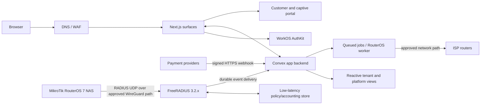
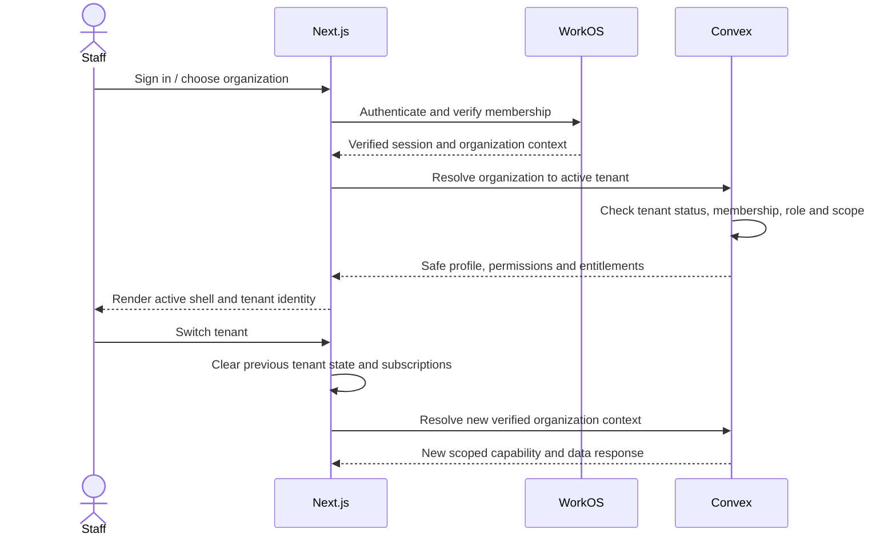

# Technical Specification: Multi-tenant ISP SaaS

**Document status:** Draft 0.3 — planning and documentation only<br>
**Date:** 11 November 2026<br>
**Product direction:** independent ISP operations SaaS, guided by locally preserved public-site and tenant-console reference images<br>
**Implementation status:** setup-only monorepo shell exists; no product features, integrations, or production infrastructure have been built

This is the master planning specification. It consolidates product scope, panel layouts, routes, workflows, design tokens, authorization, data ownership, real-time behavior, and operations. It distinguishes observed reference evidence from proposed requirements. It is not authorization to start development.

## 1. Evidence labels and reference set

Requirements use these labels:

- **Observed:** directly visible in a saved screenshot or recorded in the read-only browser review.
- **Proposed:** recommended behavior for the new product; it has not been observed in a super-admin or source-code review.
- **Open:** requires a product, security, provider, or operational decision.
- **Not verified:** the page/control was gated, loading, external, or intentionally left untouched.

### Reference files

- Tenant console gallery and route manifest: private, local-only `docs/reference-images/index.html` and `docs/reference-images/manifest.csv` (73 route/view entries).
- Approved MylesNet Design System v1.0 source: local-only extracted tree `docs/reference/mylesnet-design-system-v1.0/mylesnet-design-system/`; complete file inventory and conflict review in [MYLESNET-DESIGN-SYSTEM-V1.0-AUDIT.md](MYLESNET-DESIGN-SYSTEM-V1.0-AUDIT.md), with the canonical product contract in [DESIGN-SYSTEM-HANDOFF.md](DESIGN-SYSTEM-HANDOFF.md). The earlier token explorer is superseded historical input.
- Tenant UI review: [tenant-console-review.md](tenant-console-review.md).
- Public site gallery and route manifest: private, local-only `docs/reference-images/public-site-screenshots/` (308 sitemap routes plus captured UI states).
- Public site review: [public-site-review.md](public-site-review.md).
- The reference galleries contain live sample names, amounts, contact details, and network identifiers. Keep them private and never copy screenshot values into product fixtures. Screenshots are visual evidence, not source-code evidence; gated/loading states and scope limits are documented in the review notes.
- Existing route/role catalog: [`ROUTES-AND-ACCESS.md`](ROUTES-AND-ACCESS.md)
- Existing stack and architecture proposals: [`TECH-STACK.md`](TECH-STACK.md), [`SAAS-ARCHITECTURE.md`](SAAS-ARCHITECTURE.md)


## 2. Product goals and system boundaries

### Goal

Provide an ISP with one tenant workspace to manage subscribers, plans, network access, routers, billing, payments, vouchers, communications, support, and reports. Provide the SaaS operator with a separate platform control panel to onboard and administer tenants without routine access to tenant operational data.

### Product surfaces

| Surface | Primary users | Status and boundary |
|---|---|---|
| Public marketing website | ISP prospects | Observed. Marketing pages, feature and pricing content, solutions, tools, docs/blog, changelog, legal pages, and calls to action. |
| ISP registration and recovery | ISP owner/prospect | Observed as a multi-step flow. Recreate requirements and states, not personal reference data. |
| Platform super-admin | SaaS owner/operators | Proposed; no reference panel was inspected. Owns the SaaS control plane and platform subscription billing. |
| Tenant operator console | ISP owner/staff | Observed routes and visual shell; feature and CRUD behavior below is a proposed product contract unless marked observed. |
| Subscriber account portal | ISP customers | Proposed. Customer service, plans, payment status, invoices/receipts, preferences, and support. |
| Captive portal | Hotspot users | Partially observed via tenant settings and marketing feature pages. Final payment and router flows remain open. |
| RADIUS/network data plane | MikroTik NAS, PPPoE/Hotspot users | Proposed independent network service; it is not a browser panel or Convex UDP listener. |

### Product invariants

1. Every ISP tenant owns its subscribers, staff, plans, routers, billing records, and settings.
2. Platform subscription billing and an ISP’s subscriber billing are distinct products and ledgers.
3. A platform administrator cannot see tenant subscriber details by default. Support access is explicit, scoped, time-limited, visible, and audited.
4. Real-time views are a first-class requirement. Convex is the preferred application backend for reactive views and app data.
5. RADIUS authentication must remain responsive through transient UI/backend outages; its policy lookup and accounting durability require a separately designed network boundary.
6. Screenshots guide layout and visual language. They do not establish undocumented business rules, legal terms, or exact interactions.

## 3. Approved technical direction and remaining choices

The stack and boundary choices below are reconciled to the project charter, [`READINESS-DECISIONS.md`](READINESS-DECISIONS.md), and [`TECH-STACK.md`](TECH-STACK.md). Earlier draft alternatives are retained only where labeled as superseded or candidate. The [`DECISION-REGISTER.md`](DECISION-REGISTER.md) records authority, evidence, owners, dependencies, and revisit triggers. This remains a planning specification; selected direction is not evidence of a deployed service.

### V1 stack direction

| Layer | V1 direction / remaining status | Responsibility / boundary |
|---|---|---|
| Web framework | Next.js App Router, React, TypeScript; `apps/web` for public/subscriber routes, `apps/admin` for authenticated platform/tenant surfaces, and `apps/storybook` for design documentation/visual review. | Respect application ownership and server/client boundaries; document cross-surface session behavior before feature work. |
| Live app backend | Convex | Typed queries/mutations/actions, reactive subscriptions, transactional application writes, scheduled jobs, and live dashboard state. |
| Identity | WorkOS AuthKit for Next.js; enterprise SSO/SCIM deferred beyond v1. | Staff sign-in, invitation and membership lifecycle, MFA, and organization identity. The application owns authorization and current tenant/branch access. |
| Authorization | Convex server-side policy functions, with WorkOS organization membership as identity context | Enforce platform/tenant role and permission on every query, mutation, action, export, and job. |
| Tenant identity | One WorkOS organization mapped to one internal `tenantId` | Organization identifies the workspace; internal tenant record owns product data, branding, domains, subscription and status. |
| UI system | User-approved MylesNet Design System v1.0; Tailwind mappings and shared primitives consume generated semantic tokens. | One DTCG source and consistent accessible shells; do not fork per-panel palettes or import tokens directly in apps. |
| RADIUS service | FreeRADIUS 3.2.x. The earlier Go-service option is superseded for v1. | UDP authentication/accounting stays outside browser authorization and Convex request paths. |
| Network policy store | Dedicated PostgreSQL AAA store. The earlier PostgreSQL/Redis choice and bounded Convex-lookup alternatives are superseded for v1. | Keep RADIUS policy/accounting behavior in the independently operated network plane. |
| Router worker | Dedicated least-privilege RouterOS worker/service | Router provisioning, health polling, hotspot file sync, and approved RouterOS commands. |
| Background work | Convex scheduler/actions for bounded work; dedicated queue/worker for long-running or network-dependent work | Payment retries, imports, messaging, router jobs, domain operations, and durable event delivery. |
| Payments | Provider adapter interface; signed webhooks; idempotent Convex mutations | Separate gateway integration from application ledger rules. Do not trust browser redirects as settlement confirmation. |
| Messaging | Email, SMS, and WhatsApp provider adapters | Notifications, verification codes, billing reminders, campaigns, and delivery status. WorkOS's default sender remains for identity emails; Resend is a conditional application-email candidate, with SES Ireland as fallback. No production email or SMS provider is approved. See [public email-provider evidence](EMAIL-PROVIDER-PUBLIC-EVIDENCE.md). |
| File storage | Convex file storage or private S3-compatible storage | Branding assets, exports, statements, invoices and generated documents; retention/export needs decide final option. |
| Hosting | Vercel is the Next.js host direction, with Dublin (`dub1`) the leading function-region candidate; Convex Europe (Ireland) is the leading managed-region candidate. The earlier Node-container/Cloudflare hosting alternatives are not selected for v1. | Validate region, plan, contract, latency, capacity, failover, cost, DNS/WAF, data-transfer safeguards, and operational ownership before production. |
| Observability | Convex deployment monitoring, structured logs, Sentry/OpenTelemetry, RADIUS/router metrics | Trace requests and jobs across the web, payment, messaging, RADIUS, and router boundaries. |

Use a supported stable Next.js release, not a canary build. The exact patch, package manager, deployment target, Convex plan, hosting region, worker runtime, and network data store must be pinned only after a compatibility/cost review.

### Logical architecture



The Convex connection is the live application/data path. RADIUS and router commands stay on services designed for network protocols and credentials. Accounting/session events are delivered to Convex through a durable, idempotent event path; a direct synchronous Convex dependency for every RADIUS packet is not assumed.

### Real-time behavior

The product must update without a manual page refresh for:

- RADIUS session start, interim usage, stop, expiry, and disconnect status.
- Router reachability, health, synchronization status, and active alarms.
- Payment intent and webhook state, invoice reconciliation, and subscriber access activation.
- Subscriber/ticket changes that other authorized tenant staff are viewing.
- Campaign/message processing status and platform onboarding/provisioning jobs.

Every live query is tenant-scoped and permission-checked. Show reconnecting, stale-data, offline, and last-updated states. Never present a stale value as “online now” or “paid” without the source timestamp/status. Candidate latency targets (such as session events appearing within a few seconds) need measurement and approval; no SLO is confirmed yet.

## 4. Tenant and identity model

### Identity mapping

- WorkOS user ID is the external staff identity.
- WorkOS organization ID maps to exactly one internal tenant record. A staff identity may belong to multiple ISP organizations; only one tenant may be owned by that person/account.
- WorkOS organization context is read from a verified session/token, then resolved server-side to an active internal tenant.
- Internal `tenantId` is included on every tenant-owned Convex document and the leading scope for tenant-specific indexes/queries.
- Platform roles are stored/validated separately from tenant membership. A tenant role never grants platform-admin access.
- Subscriber/captive-portal identities and RADIUS credentials are separate from staff AuthKit identities unless a later product decision explicitly links them.

### Tenant isolation rules

1. Never authorize from a tenant ID supplied only by a URL, form, client state, or query argument.
2. Each Convex query/mutation/action validates identity, account status, active organization, tenant status, membership, permission and resource scope.
3. Include `tenantId` in indexes and query predicates; prohibit unbounded cross-tenant user-facing queries.
4. Scope exports, storage keys, cache keys, search, live subscriptions, webhook resolution and background jobs to tenant.
5. When switching organizations, invalidate tenant data, cached search, notifications and UI state before showing the new tenant.
6. Job handlers revalidate tenant and authorization context; they do not trust a request’s original claims indefinitely.
7. Unknown, suspended, domain-mismatched, or ambiguous tenants fail closed.
8. Prove isolation with two-tenant negative cases before release.

The approved v1 direction is one shared Convex deployment with strict logical tenant and branch isolation. Dedicated deployments remain a possible future isolation option after a documented scale, security, legal, and cost review; they are not part of current offers. Do not describe logical isolation as physical database-per-tenant isolation.

## 5. Panels, layouts and feature requirements

### 5.1 Public marketing site

**Observed route coverage:** 308 sitemap URLs: the homepage plus 307 non-homepage paths. Those 307 paths comprise 36 feature pages, 33 blog index/article paths, 177 changelog paths, 4 solution paths, 4 comparison paths, 1 integrations directory, and 52 other paths (country pages, calculators/tools, pricing, affiliate, legal, and related content). The screenshot capture manifest includes UI states in addition to the public sitemap paths; see `docs/public-site-review.md` for the reconciliation.

**Feature families:**

- Home and product navigation; Features, Solutions, Resources, Pricing, Integrations, country pages and calls to action.
- Feature detail pages for subscriber management, RADIUS, payments, vouchers, captive portals, router monitoring/provisioning, PPPoE, fiber/equipment, reporting, support, and integrations.
- Tools/calculators such as bandwidth, subnet, link-budget, GPON splitter, tower revenue, SLA/uptime, UPS runtime, IP/MAC and speed-test utilities.
- Public Hotspot/PPPoE usage pricing, an anonymous monthly estimate calculator, country-aware currency display, and a custom Enterprise quote request. See §14.5 for approved pricing rules and remaining validation gates.
- Default pricing currency from coarse IP country lookup (KES/UGX/TZS in launch markets; USD otherwise or on lookup failure) with a manual selector. Never request GPS or retain precise location. The Enterprise quote form collects company name, work email, countries served, estimated subscriber count, Hotspot/PPPoE usage, and a short needs summary, without credentials or registration IDs.
- Blog listing and articles; changelog listing and entries; competitor comparison pages; affiliate information; terms/privacy/legal content.
- Sitemap and canonical metadata, search/discovery, SEO-friendly server rendering, responsive layouts, cookie/consent behavior where required.

**Public content CRUD:** Editorial management remains a candidate, not an approved feature. All 308 inventoried public URLs stay static/structured unless an approved editing need names exact routes and an accountable owner. Tenant staff cannot manage MylesNet public content. Before building any editing capability, decide author/reviewer/publisher permissions, draft/review/publish/unpublish/schedule states, version history, preview isolation, slug redirects, audit, localization, cache/index updates, and correction/rollback behavior. See the [public-content editorial decision packet](PUBLIC-CONTENT-EDITORIAL-DECISION-PACKET.md). Marketing publication cannot modify operational tenant data.

### 5.2 ISP registration and account recovery

**Observed:** multi-step registration with identity verification, tenant identity/address, country and referral selection, password/security and final provisioning feedback. Reference showed Uganda, Africa/Kampala, and UGX; treat these as reference defaults, not a final launch-country decision. Public registration showed dark/light appearance; a System theme control was not observed there.

**Proposed behavior:**

1. Collect and verify the first Owner's email before automatic provisioning; phone can be added and verified later. Throttle resend/attempts and protect against enumeration.
   - Enforce the confirmed rule that a person/account may own at most one ISP tenant; define a clear duplicate-ownership response.
2. Collect ISP/company name, tenant subdomain, country, timezone and billing currency. Keep the chosen subdomain stable after signup; a verified Owner may later request a rename. Retain the previous subdomain as a tenant-owned redirect alias and never reassign it. The display name can change independently.
3. Collect consent/terms and referral source.
4. Select standard Hotspot and/or PPPoE usage pricing, or request a custom Enterprise quote. Hotspot and PPPoE share the standard platform feature set; a tenant may use either or both. Start the 14-day trial after email verification without an upfront payment method; require billing setup and explicit tenant confirmation before the first charge. Standard usage renews monthly and has no annual-prepayment discount; Enterprise may negotiate annual commitments. The first successful paid invoice establishes the monthly billing anchor; when a cycle lacks that date, use the cycle's last calendar day and return to the original anchor date next cycle. Generate an invoice each month. Mobile money, bank transfer and card require a tenant-initiated **Pay** action; only separately enabled wallet auto-pay charges automatically. Keep service through the paid period after cancellation. Show usage rates, minimum, currency/FX treatment, tax, renewal and cancellation terms before a charge.
5. Create the internal tenant and WorkOS organization idempotently; provision default membership, roles and tenant settings.
6. Retry transient provisioning steps idempotently within a bounded policy; preserve progress, show current status, and expose a support path after the threshold. Keep exact retry/backoff values and alert escalation ownership in the implementation runbook. Do not tell the user the workspace is ready until provisioning and Owner access succeed.
7. Require MFA at sign-in for platform administrators. Tenant Owner MFA is optional at sign-in, but high-risk actions and ownership transfer require MFA step-up/enrollment. Support recovery uses verified channels and the approved cooling-off process.

**Open:** SaaS subscription checkout provider, legal terms, exact deletion/retention schedules, DNS/TLS automation validation, and selection of the external registrar link. Block a repeated Owner identity or subdomain, but allow duplicate business names; do not collect government-issued business registration IDs in v1. Signup is self-service after email verification with the selected 14-day trial. Failed provisioning uses bounded idempotent retries and a support path; exact thresholds remain in the runbook.

### 5.3 Platform super-admin panel (proposed)

**Shell:** separate platform identity and neutral brand; no tenant custom colors. Left navigation, top-level search, operator profile/MFA state, environment/health indicator, and content area. Tenant support sessions must be visibly distinct from platform mode.

| Route group | Required features |
|---|---|
| Overview | Tenant totals and lifecycle breakdown, pending onboarding, provisioning failures, subscription collection status, integration health, queue health, incidents and platform alerts. No unnecessary subscriber PII. |
| Tenants | Search/filter tenants, inspect lifecycle and plan, create/onboard, manage owner invitation, domain state, limits, suspend/reactivate, export, offboard, and view provisioning history. Destructive transitions require reason and confirmation. |
| Pricing, usage meters and Enterprise quotes | Configure versioned Hotspot/PPPoE rates and effective dates, Enterprise quotes and negotiated terms, usage definitions, local-currency tables, monthly minimums, tax presentation, FX source and public calculator inputs. No subscriber/router count cap is a commercial entitlement. |
| Platform subscriptions | Monthly subscription status, active-until/amount-due/due-date summary, invoices, local mobile money/bank transfer/card payment where supported, grace period, credits/refunds, cancellation and billing history. Collect through MylesNet's own merchant accounts, separate from ISP subscriber collections; provider adapters may be reused. MylesNet absorbs its own subscription-invoice processing costs; no separate processing-fee line. Eligible tenants using MylesNet-managed collections may opt in to wallet auto-pay: only the Tenant Owner can enable/disable it with MFA step-up; attempt one day before invoice due date and retry hourly until covered. The first successful paid invoice anchors monthly billing; for a cycle missing that date, use the last calendar day, then resume the original anchor next cycle. |
| Domains | Stable tenant subdomain and owner-requested rename aliases; custom domain setup via one generated DNS A record, explicit DNS verification, automatic HTTPS provisioning, active/previous address list and safe callback migration. Preserve each tenant's prior host until the Owner confirms integrations have moved and explicitly stops serving it. Custom domains are included in every plan. **Buy a domain** opens a supported external registrar; after purchase, the tenant returns to DNS setup. Select the registrar link before implementation. |
| Platform operators | Invite/deactivate operators, assign roles, enforce MFA, review sessions and revoke sessions. |
| Support access | Request/approve tenant support grant; capture reason, case link, tenant, permitted scope, expiry, session banner and access audit. No unrestricted impersonation. |
| Integrations | Provider configuration status, callback health, RADIUS/RouterOS service status, secret rotation workflow and failure history. Reveal secrets only once or not at all. |
| Operations | Provisioning jobs, queue/worker status, scheduled jobs, backup state, incidents, maintenance notices and service flags. |
| Audit and policy | Search immutable platform audit events, access reviews, retention rules and controlled exports. |
| Marketing content | CMS remains unapproved. If an editing need is approved, platform editorial roles or an approved CMS may manage only the selected public routes under the [editorial decision packet](PUBLIC-CONTENT-EDITORIAL-DECISION-PACKET.md); tenant staff cannot publish MylesNet marketing content. |

### 5.4 ISP tenant operator console

**Observed shell:** persistent left navigation rail grouped into Overview, Customers, Network, Finance, Outreach and Insights; expandable Finance/Communications groups; bottom Academy and “What’s new” links. Top bar includes page title/breadcrumb, global subscriber/router/payment search, Ask AI, Support and profile menu. Settings uses its own settings navigation. Main work area is centered/bounded, with white cards on pale neutral page, compact tables/forms, subtle borders/shadows, rounded corners and orange accent. The theme selector offers Light, Dark and System.

**Observed dashboard content layout:** tenant greeting/shift context and traffic summary; live event strip; KPI cards for revenue, active subscriptions and online users; recent activity; “What’s next” attention list; renewals due; busiest router/traffic; subscriber-health chart/card. Counts in captures are sample-time data, not requirements for actual values.

#### Tenant feature groups and page inventory

| Group | Pages/features (reference paths) | Proposed CRUD and actions |
|---|---|---|
| Overview | `/dashboard` | Read dashboard cards and live activity; drill into source records; attention items deep-link to authorized work. No direct data mutation on summary cards. |
| Subscribers/customers | `/users`, `/users/create`, `/users/compensate`; customer search/detail, import/export | Create, list/read, update, deactivate/archive; contact/plan/expiry/device changes; guided CSV imports with validation, duplicate checks, dry-run preview, audit and safe batch rollback; export by permission; batch compensation requires reason/approval and audit. |
| Leads | `/leads`, `/leads/import-export` | Create/read/update/assign/stage; archive/convert with history; guided CSV import with validation, duplicate checks, dry-run, audit and safe rollback. |
| Support tickets | `/tickets`, `/tickets/create`, `/tickets/import-export`, `/tickets/analytics` | Create/read/update/assign/status/priority/comment/resolve/reopen; scoped imports/exports; reporting. Customer portal only sees own tickets. |
| Sessions and packages | `/active-users`, `/packages`, `/packages/create` | Live read for sessions; disconnect/reconnect is a privileged command, not ordinary delete. Plans create/read/update/archive; used plans cannot be hard-deleted. |
| NAS/router/network map | `/nas`, `/nas/create`, `/nas/71564`, `/nas/71564/web-console`, `/network-map` | Router registration and tenant mapping, status, configuration, sync, health, credential rotation; commands are permission-gated and audited. External router web console is not embedded as SaaS admin access. |
| CPE and firmware | `/cpe`, `/cpe/firmware` | Read/update inventory and firmware policy; schedule approved changes; record versions/results. TR-069/ACS capability is a later scope decision. |
| Equipment/fiber | `/equipment`, `/equipment/create`, `/fiber/map` | CRUD inventory, assignment, subscriber linkage and map metadata; disposal/archive retains audit history. |
| Payments | `/payments`, `/payments/create`, `/payments/import-export` | Create manual payment only with permission; list/read/reconcile; update only pending metadata; reverse/void with reason. Settled records are immutable; exports are separately granted. |
| Invoices/finance | `/invoices`, `/invoices/create`, `/expenses`, `/expenses/create` | CRUD draft invoices/expenses; issue/send/settle/credit-note actions require permissions. Posted invoices and ledger facts are corrected with reversals/credit notes, not deletion. |
| Credits/loyalty | `/outage-credits`, `/loyalty-points` | Create/review/adjust with reason and approval; maintain immutable adjustment history and exposure limits. |
| Vouchers and agents | `/vouchers`, `/vouchers/batches`, `/vouchers/sales`, `/vouchers/templates`, `/agents` | CRUD unissued batches/templates/agents; issue, sell, assign, print and redeem with permissions; void issued/redeemed codes with reason; snapshot price/commission at sale. |
| Communications | `/sms`, `/sms/create`, `/sms/campaigns`, `/sms/campaigns/create`, `/whatsapp`, `/whatsapp/create`, `/campaigns`, `/campaigns/create` | Create/edit drafts; preview audience/cost; approve/send; read delivery/failure state; cancel queued send when possible. Consent, opt-out, rate and budget limits are mandatory. |
| Analytics | `/analytics` | Read tenant-scoped reports with bounded time ranges, source timestamps and permission-controlled export. Finance and network data may require separate permissions. |
| Changelog/referrals/feedback | `/changelog`, `/referrals`, `/feedback-board` | Read product notices; view and manage tenant referral/feedback if enabled. Public product changelog authoring is platform-controlled. |
| Staff/audits | `/staff`, `/staff/roles`, `/audits` | Owner/admin manages staff and scoped roles; audit events are append-only/read-only. Role changes and invitations are audited. |
| Tenant settings | `/settings/branding`, `/settings/domain`, `/settings/network/pppoe`, `/settings/network/hotspot`, `/settings/payments`, `/settings/communications/sms`, `/settings/communications/email`, `/settings/communications/whatsapp`, `/settings/message-templates`, `/settings/loyalty`, `/settings/notifications`, `/settings/ai`, `/settings/integrations/accounting`, `/settings/developer`, `/settings/profile`, `/settings/security` | CRUD by setting domain and role; secrets are write/rotate-only, never readable after save. High-risk security changes require MFA step-up; lower-risk changes require fresh authentication. Domain changes require verification. |
| Tenant subscription | `/subscription` | Read plan/usage and invoices; update plan/cancel only by owner/authorized finance role, with explicit effective date and confirmation. |

The paths above follow the observed tenant routes. The references do not confirm every detail, form submission, destructive action, export, or external link. UI controls must be specified from product requirements before coding.

#### Guided CSV import (v1)

Provide a permission-gated, tenant/branch-scoped wizard for supported entity types. It offers templates/instructions, validates file structure and field mapping, checks duplicates within the file and against existing records in the selected tenant scope, and presents a dry-run preview before any mutation. Duplicate rows are flagged; the importer never silently merges or overwrites existing data. Require explicit commit, show per-row outcomes/progress, and write an audit trail for upload, mapping, validation, commit and rollback. Tag imported records with their `ImportJob` so rollback can safely target only the originating batch. Roll back only records that remain unchanged and have no downstream dependency; preserve immutable audit/financial history and route unsafe rows to an explicit reconciliation path. Named system-specific connectors are deferred beyond v1. Entity coverage, exact templates/matching keys, partial-failure behavior, file/batch limits and retention remain build-contract decisions.

The [guided CSV migration contract](CSV-MIGRATION-CONTRACT.md) records the Phase 0 sequence, acceptance cases, and owner decisions required before implementation.

### 5.5 Subscriber account portal (proposed)

- Sign-in/recovery using a subscriber-safe method; do not expose staff AuthKit or staff roles.
- Show own service(s), plan, expiry/quota, invoice/payment status, receipts and service notices.
- Renew/select eligible plans; create a payment intent; show pending/success/failure/expired states and retry guidance.
- Update permitted contact details and communication choices; create/review own support tickets.
- Tenant-selected branding, support contacts, terms, and locale; apply the approved theme to the account portal and captive portal. All reads/writes are scoped to the verified subscriber identity and tenant.

### 5.6 Captive portal (proposed from partial reference)

- Render the shared portal template with the approved tenant theme inputs (logo, mark, primary brand color, approved font, shape preset, and optional login image) using mobile-first plan tiles. Do not accept custom CSS or arbitrary fonts. Secondary accent support remains disabled until the package derivation gap is resolved.
- Support plan selection, voucher entry, returning subscriber login, required terms, payment handoff, pending and final result pages.
- Prevent duplicate payment prompts and duplicate activation. Verified provider callback or reconciliation event—not the redirect page—authorizes service.
- Provide safe fallback for browser captive detection, no JavaScript, temporary connectivity, expired checkout, and unavailable provider.
- Version templates per tenant/router, preview at phone sizes, sync with status, and allow rollback.
- Portal content and checkout code are isolated from staff admin routes and credentials.

### 5.7 RADIUS and router operations

- Support scope begins with MikroTik Hotspot and PPPoE, subject to confirmation of RouterOS versions and lab coverage.
- RADIUS validates NAS identity/shared secret and maps each NAS to one tenant before checking credentials/policy.
- Policy covers account enabled state, plan, expiry, quota, speed profile, simultaneous session/device limits, and access type.
- Persist accounting Start/Interim/Stop idempotently; maintain a recoverable active-session projection in Convex for live panel subscriptions.
- Disconnect/CoA and router changes are auditable jobs with approval policy, timeout, response, retry and rollback/compensation record.
- Router secrets are encrypted in a secret manager, never returned in API/UI, logs, exports, screenshots or browser storage.
- Use FreeRADIUS 3.2.x with the dedicated PostgreSQL AAA store. If RADIUS connectivity fails, retain current sessions and reject new logins; never fail open. RouterOS 7 provisioning uses a least-privilege WireGuard tunnel limited to RADIUS and CoA/Disconnect, with WinBox, SSH, and RouterOS API blocked.
- Still specify HA topology, the exact allowed tunnel paths and source checks, policy synchronization/cache invalidation, accounting recovery, supported RouterOS patch/device matrix, provisioning-token lifetime, and isolated lab acceptance. Do not connect real routers during planning.

## 6. CRUD and RBAC specification

### Permission vocabulary

- `C` create; `R` list/read; `U` update; `D` delete/archive; `—` none.
- `CRUD` is full access within the role’s tenant and field scope. `CRU` excludes delete. `R*` means read with masking or aggregation. `Own` means records belonging to the signed-in subscriber. `Sys` means created only by a trusted system workflow.
- Role names are permission bundles, not code branches. The user’s identity and tenant membership are checked server-side for every operation.
- Full CRUD is provided where the record lifecycle permits it. For financial, access, communication-consent and audit records, “D” means an approved void/reversal/deactivation workflow rather than erasing history. Audit events themselves cannot be updated or deleted.
- Additional verbs are distinct permissions: `export`, `issue`, `send`, `refund`, `credit`, `disconnect`, `router.command`, `secret.rotate`, `role.assign`, `tenant.suspend`, `support.start`, `support.approve`, `publish`, and `offboard`.

### Platform control-plane matrix (proposed)

The v1 platform roles are Platform Owner, Operations, Finance, Support, Security Admin, and Auditor. Security Admin is a distinct MFA-protected role and approves high-risk tenant-owner recovery independently from the support initiator.

| Resource | Platform owner | Platform operations | Platform finance | Platform support | Platform Security Admin | Platform auditor |
|---|---|---|---|---|---|---|
| Tenants | CRUD; approve offboard | CRU; suspend/reactivate | R | R metadata | R security metadata | R |
| Domains/provisioning | CRUD; verify | CRU; retry provisioning | R status | R status | R security findings | R |
| SaaS plans/entitlements | CRUD | R | CRU pricing/entitlement within policy | R | — | R |
| Platform subscriptions/invoices | CRUD; approve adjustments | R | CRU; refund/credit by approval | R status | — | R |
| Platform operators/roles | CRUD | R; no self-escalation | R | R | R MFA/access-review status | R |
| Support grants | R/oversight/revoke | R status | R | C request/R assigned; access only after Tenant Owner approval | Approve documented emergency exceptions | R |
| Owner recovery cases | R status | R status | — | C/verify; R assigned | R; approve high-risk cases | R audit |
| Provider configuration | CRUD/rotate | CRU/rotate assigned providers | R status | R status | — | R metadata |
| Jobs/incidents/maintenance | CRUD policy | CRU operational | R finance jobs | CRU assigned cases | R security incidents | R |
| Platform audit events | R | R | R | R | R | R |

Platform audit event writes are system-only. No role can edit/delete audit rows. Secret values are never readable, including to the platform owner after the value has been stored.

Standard tenant-data support access is read-only and requires the Tenant Owner’s approval of a time-limited, tenant/resource-scoped grant, with a visible in-session banner and audit trail. The Tenant Owner may explicitly allow internal support notes and corrections to non-sensitive contact/profile fields only. Support grants exclude finance, credentials, roles, network/router actions, messaging, exports, deletion, and suspension. Each grant expires within **one hour**; extension requires a new approval. A documented emergency exception requires Platform Security Admin approval plus approval from a different Platform Security Admin or Platform Owner; no approver may approve their own request. Notify the tenant when emergency access begins; emergency grants remain read-only.

### Tenant operational matrix (proposed)

V1 built-in tenant staff roles: **Owner** tenant owner; **Admin** tenant administrator; **Fin** finance; **Net** network operator; **Sup** support; **Sales** sales/agent; **Analyst** read-only analyst. Each tenant has exactly one active Owner. Subscriber accounts use a separate identity and authorization model; the Subscriber column below describes only self-service access and does not make subscribers tenant staff roles.

| Tenant resource | Owner | Admin | Fin | Net | Sup | Sales | Analyst | Subscriber |
|---|---:|---:|---:|---:|---:|---:|---:|---:|
| Subscribers/accounts | CRUD | CRUD | R* | RU network fields | CRU limited/masked | CR assigned leads | R* | R/U own contact only |
| Leads | CRUD | CRUD | R | — | R/CRU if assigned | CRUD assigned | R | — |
| Tickets | CRUD | CRUD | R | CRU assigned network tickets | CRUD assigned | R/CRU assigned | R | CRU own ticket |
| Plans/access profiles | CRUD | CRUD | R | CRU technical fields | R | R | R | R published plans |
| NAS/routers | CRUD | CRUD | R status | CRUD | R status | — | R metadata | — |
| Active sessions | R + command | R + command | R* | R + disconnect/CoA | R* limited | — | R aggregate | R own session |
| Payment attempts/payments | CRU/reverse | R/approve | CRU/reconcile | — | R* | R assigned sales only | R aggregate | R own payment |
| Invoices/credit notes | CRUD draft/issue | CRU/approve | CRUD draft/issue/credit | — | R* | — | R aggregate | R own invoices |
| Ledger entries | R/review | R | C/reverse only | — | — | — | R aggregate | R own statement only |
| Expenses | CRUD | CRUD | CRUD | — | — | — | R aggregate | — |
| Voucher batches/vouchers | CRUD | CRUD | R/reconcile | R policy | R* support | CRUD assigned | R aggregate | R/redeem own |
| Agents/commission | CRUD | CRUD | R/reconcile | — | R assigned | RU own profile | R aggregate | — |
| Campaigns/messages | CRUD/approve | CRUD/approve | R cost | — | CRU/approve scope | CRU assigned | R aggregate | R own messages/preferences |
| Equipment/CPE | CRUD | CRUD | R cost | CRUD | R assigned | — | R | — |
| Staff/memberships/roles | CRUD | CRUD low-risk staff/role assignments; no self-escalation | — | — | — | — | — | — |
| Branding/domain | CRUD | CRU | R | R portal status | R | — | — | R tenant brand |
| Payment/provider settings | CRUD/rotate | R status | CRU/rotate assigned | — | — | — | — | — |
| Network settings | CRUD | CRUD | R | CRUD | R | — | — | — |
| Messaging/templates/notifications | CRUD | CRUD | R cost | — | CRU assigned | CRU assigned | R | U own preferences |
| Developer/API settings | CRUD/rotate | R metadata | — | R metadata | — | — | — | — |
| Analytics/reports | R | R | R finance | R network | R support | R assigned | R approved datasets | R own usage |
| Tenant audit events | R | R | R finance | R network | R support | R assigned | R limited | R own history |
| Feedback/referrals/changelog | CRUD tenant feedback | CRUD tenant feedback | R | R | CRU assigned | CRU assigned | R | C own feedback/R notices |

Apply field-level masking to phone, payment provider references, router secrets, credentials, and private messages as appropriate. “CRUD” never permits a role to cross tenant boundaries or override another role’s limits.

### Sensitive actions and approvals

| Action | Minimum proposed control |
|---|---|
| Export subscriber/payment data | Owner-approved sensitive `export` grant; scope/date filter, audit event, MFA step-up and rate limit. |
| Manual payment, credit or refund | Finance permission; Owner-approved grant for refund/credit authority; idempotency/reference validation; reason; tenant-configured approval threshold; immutable reversal history. |
| Withdraw funds or change payout destination | Owner-approved, branch-scoped withdrawal permission; every withdrawal requires a one-time code sent to the current Tenant Owner’s verified email, which changes on ownership transfer. Only the Owner may approve destination additions/changes. |
| Disconnect session or issue router command | Network permission; Owner-approved grants for destructive/bulk actions; target/impact preview; reason; tenant/NAS verification; queued audit and result. |
| Send campaign/bulk message | Owner-approved bulk-messaging permission; draft/preview/audience count/cost, consent check, approval, send limit, delivery status and cancellation when possible. |
| Reveal/rotate secret | Owner-approved permission; no read-back; secret-manager write/rotate flow, MFA step-up and audit. |
| Suspend tenant/offboard | Platform role, reason, impact preview, approval, export/retention steps and recoverable grace policy. |
| Platform support access | Approved grant with tenant, reason, case, scope, expiry, banner, action logging and revocation. |
| Change role or permission | Tenant Owner grants/approves high-risk permissions, including delegation authority; Admin composes lower-risk custom roles within their own permission ceiling. Prevent all self-escalation; use MFA step-up for high-risk grants/revocations and write an audit event. |

## 7. Design system and token specification

The approved MylesNet Design System v1.0 package is the canonical token input. [DESIGN-SYSTEM-HANDOFF.md](DESIGN-SYSTEM-HANDOFF.md) records the application contract; [MYLESNET-DESIGN-SYSTEM-V1.0-AUDIT.md](MYLESNET-DESIGN-SYSTEM-V1.0-AUDIT.md) inventories every archive entry and lists conflicts and source gaps. The system has three tiers—primitive, semantic and component—with email/PDF platform adapters. DTCG JSON is authored source; CSS, resolved JSON, Tailwind and renderer outputs are generated under the `--mn-*` namespace.

All product surfaces share semantic tokens and component behavior while retaining audience-appropriate shells. Appearance is Light, Dark or System; forced-colors is an accessibility behavior. Comfortable is default, Compact is selectable, and Touch sizing is device-driven. Tenant brand inputs follow the v1.0 schema and stay within verified tenant-facing surfaces. Status, focus, security, spacing scale, type sizes, shell geometry and touch minimums remain platform-controlled. Saved product screenshots remain layout/workflow references only. Custom portal domains follow the separate approved all-offer DNS A-record/Verify DNS/automatic HTTPS workflow, not the conflicting CNAME/paid-offer text in the package.

## 8. Conceptual data model and event ownership

### Core logical records

**Platform scope:** `PlatformUser`, `PlatformRole`, `Tenant`, `TenantDomain`, `PlatformPriceSchedule`, `TenantEntitlement`, `TenantSubscription`, `PlatformUsageEvent`, `TenantUsagePeriod`, `PlatformInvoice`, `PlatformInvoiceLine`, `PlatformPayment`, `EnterpriseQuoteRequest`, `ProvisioningJob`, `SupportGrant`, `ProviderCredentialReference`, `PlatformAuditEvent`.

**Tenant scope:** `TenantMember`, `TenantRole`, `TenantSettings`, `Subscriber`, `ServiceAccount`, `ServicePlan`, `NAS/Router`, `AccessProfile`, `RadiusCredentialReference`, `RadiusAccountingEvent`, `ActiveSessionProjection`, `PaymentAttempt`, `TenantPayment`, `LedgerEntry`, `Invoice`, `CreditNote`, `Expense`, `VoucherBatch`, `Voucher`, `SalesAgent`, `Campaign`, `MessageDelivery`, `SupportTicket`, `Equipment/CPE`, `ImportJob`, `TenantAuditEvent`.

`ImportJob` records the tenant and optional branch scope, entity/template version, actor, secure source-file reference/digest, mapping, validation and duplicate summary, dry-run result, explicit commit state, row-level outcomes, retry/rollback state and audit correlation. Do not retain uploaded source contents longer than the approved retention policy or copy row-level secrets into logs/audit summaries.

Every tenant-owned record has tenant ID, creation/update actor, timestamps, status/lifecycle, retention class and access rule. Secrets are references to a secret store, never plaintext application fields.

### Event ownership

| Fact | Authoritative producer | Convex responsibility |
|---|---|---|
| Staff identity/MFA/org membership | WorkOS | Map verified identity/org to application user and tenant; enforce current status and app permissions. |
| Payment settled/failed/reversed | Payment provider callback plus reconciliation policy | Verify signature, deduplicate, record immutable financial event and update live UI projections atomically. |
| RADIUS auth decision | RADIUS service + current policy source | Store visible result/telemetry and update session projection; preserve accounting event durability. |
| Router health/config result | Router worker or router callback/poll | Store time-stamped status and stream authorized updates. |
| Message delivery | Messaging provider callback | Record idempotent delivery state and stream campaign progress. |
| SaaS subscription event | Platform billing provider or authorized platform workflow | Update platform ledger/subscription state separately from tenant collection ledger. |
| Tenant CSV import job | Authorized tenant operator and import service | Validate and preview without writes; on explicit commit, process idempotently in verified tenant/branch scope, report row outcomes, audit lifecycle, and allow only safe batch-scoped rollback. |

### Financial rules

- Define currency on every financial transaction; avoid floating-point money. Select integer minor units or currency-aware fixed precision per supported currency.
- Store payment intent, provider transaction, allocation, fee, refund/reversal and reconciliation as explicit linked records.
- Use idempotency keys at provider callback and user-command boundaries.
- Settled ledger/invoice facts are append-only. Corrections are reversal/credit/debit entries with actor, reason, reference and timestamp.
- Balance, revenue, commission and tax reports include a query period, currency, source and reconciliation status.
- Keep platform SaaS collections and tenant ISP subscriber collections in distinct record types, permission groups and reports.

### Real-time event flow

1. Trusted integration receives an event and validates signature/client identity.
2. Resolve the correct tenant from server-side provider/NAS mapping, not request body tenant fields.
3. Validate idempotency and schema; append the immutable event and update materialized/live projections in a transaction where possible.
4. Convex subscriptions rerun only for authorized, tenant-filtered readers.
5. Failed external delivery is durably retried; event ID and attempt history remain available to operations.
6. Reconciliation jobs compare external provider/router state to stored state and record differences rather than silently overwriting history.

## 9. API, integration and security requirements

### Web and server actions

- Next.js Server Actions/Route Handlers are untrusted entry points: validate input, identity, tenant mapping, permission, CSRF/origin/session state, and idempotency at the operation boundary.
- Convex public functions are validated and permission-checked; internal functions are used for trusted integration/job work.
- WorkOS API secrets and Convex deploy keys stay server-side. Public browser configuration contains only intended client identifiers/URLs.
- Use separate WorkOS and Convex development, staging and production environments. Never mix production data/secrets with previews.

### Payment, messaging and accounting integrations

- Provider adapters define create/lookup/refund/reconcile capabilities and normalized statuses.
- Verify webhook signatures and replay timestamps; acknowledge only after durable event acceptance; retry safe idempotent work.
- Use a provider-specific reference as well as an internal immutable payment ID. Do not match payments only by phone number.
- Store consent/source/time for SMS, email and WhatsApp; support opt-out, delivery callbacks, retry caps and campaign cost limits.
- Keep WorkOS's default identity-flow email separate from MylesNet application email. Resend remains conditional on country transfer/contract review and local inbox pilots; SES in Ireland is the fallback candidate, not a data-residency or legal approval. Public findings and open validation are in [EMAIL-PROVIDER-PUBLIC-EVIDENCE.md](EMAIL-PROVIDER-PUBLIC-EVIDENCE.md).
- Accounting integration exports explicit mapped entries and marks success/failure per batch; no hidden silent overwrite.
- Gateway list and country coverage are open. Reference page showed several gateways but no settings were changed or credentials tested.

### RADIUS and network controls

- RADIUS service accepts only expected NAS identities, shared secrets and source/network policy; rotate credentials without logging them.
- Rate-limit malformed/auth-failure traffic; monitor latency, accepts/rejects/timeouts/retries and accounting lag.
- Use bounded timeout and retry budgets. RADIUS outage behavior is approved: keep current sessions and reject new logins; never fail open. Specify separate degraded-mode behavior for other database/network dependencies without weakening that policy.
- Buffer accounting locally/durably if Convex cannot be reached; deduplicate on NAS/session/event identifiers.
- Router commands use least-privilege accounts, allowlisted actions, approval where impactful, audit, timeout and result capture.
- Do not expose Winbox/RouterOS console credentials or management ports through the browser application.

### Security and privacy

- Require MFA at sign-in for platform administrators. Tenant-staff MFA enrollment remains optional at sign-in; require MFA step-up for high-risk actions (including financial changes, credential rotation, role/permission changes and destructive or bulk operations), and deny those actions to staff without an enrolled factor. Subscriber MFA remains required for its designated sensitive portal actions.
- AuthKit `max_age` reauthentication proves recent authentication but may prompt for a password or an MFA factor based on the user’s enrolled methods; do not treat an updated `auth_time` alone as proof of an MFA challenge. Keep environment-wide MFA disabled for tenant staff. Require MFA for platform administrators through the platform-operator organization policy. Allow optional tenant-staff TOTP enrollment through the WorkOS MFA API, and require an independently verified TOTP challenge before high-risk actions; users without an enrolled factor are denied those actions. Hosted AuthKit’s global/org MFA policies are not the per-action control for tenant staff. Validate the exact factor-enrollment, challenge/verification, platform/tenant separation and failure behavior in a pre-build compatibility spike; enterprise SSO is deferred in v1. [AuthKit reauthentication](https://workos.com/docs/authkit/reauthentication), [AuthKit MFA](https://workos.com/docs/authkit/mfa), [WorkOS MFA API](https://workos.com/docs/mfa), [organization authentication policies](https://workos.com/docs/authkit/organization-policies).
- Tenant policy checks on reads and writes; no tenant ID trust from browser; test cross-tenant reads, writes, exports and live subscriptions.
- Encrypt transport; encrypt secrets at rest; use secret manager and rotation workflow; redact logs and traces.
- Apply field masking for PII, payment references, subscriber credentials, and private message content.
- Keep append-only platform/tenant audit events with actor, tenant, action, resource, reason, timestamp, correlation ID and safe before/after summary.
- Define privacy notices, consent, data retention, legal hold, export/deletion, access requests, breach response and data residency before launch.
- Use provider-hosted checkout/tokenization where possible; do not store raw card data.

## 10. Non-functional requirements (targets to approve)

| Area | Requirement |
|---|---|
| Real-time | Define measurable event-to-screen latency for session, router, payment, support and campaign updates; show staleness/reconnect states. Initial numeric SLO is open. |
| Availability | Define separate availability targets for web UI, Convex backend, RADIUS authentication and router worker. RADIUS failure must be observable and have an explicit policy. |
| Performance | Paginate lists, bound report dates, use indexed tenant queries, cap bulk work, and avoid full-tenant scans for dashboard pages. |
| Scale | Set initial and 12-month tenant, subscriber, active session, router, event, and message-volume estimates before production plan selection. |
| Accessibility | Target WCAG 2.2 AA unless product/legal review selects another target; support keyboard, focus, screen readers, reduced motion and OS forced-colors alongside Light/Dark/System. |
| Responsive | Support desktop operator workflows and usable tablet/mobile layouts; captive portal is mobile-first. Browser/device matrix is open. |
| Localization | Store timestamps in UTC and render tenant timezone; define currency precision, locale/date formats, languages and translation ownership. |
| Recovery | Define backup frequency, retention, restore drills, recovery point objective (RPO), recovery time objective (RTO), and tenant-level restore/export process. |
| Observability | Correlate user actions, Convex functions, provider callbacks, RADIUS requests and router jobs without exposing secrets or raw credentials. |
| Operations | Named service owner, alert routing, incident severity, support hours, maintenance process and rollback criteria required before launch. |

## 11. Quality gates and acceptance criteria before development

The following must be reviewed and approved before implementation begins:

1. Product scope and prioritized MVP, including an owner-approved route list for any public URLs needing editing; all 308 remain in scope as static/structured pages unless this need is approved. Use the [editorial decision packet](PUBLIC-CONTENT-EDITORIAL-DECISION-PACKET.md) to record route, ownership, workflow, locale, and vendor evidence.
2. Route/menu catalog for public site, platform admin, tenant console, subscriber portal and captive portal.
3. CRUD/RBAC matrix above refined to field-level permissions and all special actions; every route has an explicit allow/deny owner.
4. Tenant isolation design and proof strategy for WorkOS organization mapping, Convex queries, background jobs, storage and live subscriptions.
5. RADIUS/network decision: service implementation, policy store, NAS tenant mapping, event outbox, outage behavior, test hardware and safe network.
6. Payment/messaging/accounting provider list, sandbox availability, country/currency matrix, and callback contracts.
7. Approved v1.0 DTCG source and cross-surface handoff are recorded. Before implementation, resolve the audit’s schema-ID, secondary-accent, shape-preset, dark-output, contrast/chart-validation and runtime-integration gaps; do not describe unrun checks as passed.
8. Data dictionary, states, retention, PII classification, audit policy, financial ledger rules, export/deletion and migration plan. For CSV imports, define supported entity/templates and source mappings, duplicate matching/resolution, limits/retention, partial-failure behavior and safe rollback boundaries; named system connectors are deferred beyond v1.
9. Hosting/cost estimate, environments, domains, backups, monitoring, RPO/RTO, support and incident owners.
10. Verification plan for CRUD, cross-tenant authorization, live events, payment idempotency, RADIUS authentication/accounting, responsive UI and accessibility.

### Release acceptance criteria

- A user with no tenant membership cannot list/read/create/update/delete any tenant record or subscribe to its live data.
- A tenant member cannot access another tenant by changing a URL, argument, host header, export URL, or cached browser state.
- Platform super-admin does not see subscriber details unless an approved support grant permits it; access is visible and audited.
- Every resource in the CRUD matrix enforces its defined verbs server-side; immutable records use reversals/archives rather than hard deletes.
- All real-time cards show a trustworthy state, timestamp/freshness and reconnect behavior. No pending payment is labeled settled.
- RADIUS auth remains within the approved latency/outage policy and accounting events survive transient delivery failures without duplicate ledger effects.
- Theme modes, tenant branding, focus, validation, empty/loading/error states and responsive layout match approved reference-derived design QA.
- Backups restore successfully to an isolated environment; tenant export/offboarding follows approved retention rules.

## 12. Decisions still open

- Exact product-brand expression and reference-derived visual treatment; the product name and four-surface scope are approved.
- Which public routes need editable behavior, content ownership, and editorial/release workflow. The [editorial decision packet](PUBLIC-CONTENT-EDITORIAL-DECISION-PACKET.md) provides a route-family inventory and decision criteria; it does not approve a CMS. All 308 captured public URLs remain in v1 scope as static/structured content unless a justified editing need is approved.
- Exact platform-admin navigation and detailed support/audit workflow contracts. The platform surface and the charter's scoped support-grant policy are approved; route/action acceptance remains to be cataloged.
- Fine-grained role/action permissions, subscriber authentication/recovery contracts, and negative acceptance cases. The v1 built-in roles, branch-scope model, and SSO/SCIM deferral are approved.
- Workload, rate/query/queue limits, indexes, capacity and cost budgets; future dedicated-tenant thresholds. V1 uses one shared Convex deployment with strict tenant/branch isolation.
- RouterOS device/version lab matrix, allowed connectivity paths, provisioning implementation, portal asset sync/rollback and provider-return/outage handling. FreeRADIUS 3.2.x, PostgreSQL AAA, and fail-closed new-login behavior are approved.
- Provider contracts, sandbox/live readiness, merchant-account ownership/fees, country-specific pooled-collection approval, and the selected email/SMS/WhatsApp/domain/DNS/TLS/accounting vendors. Candidate providers are recorded in [`DECISION-REGISTER.md`](DECISION-REGISTER.md); candidate status is not approval. For email, WorkOS identity delivery remains separate from application email; see [MN-PLAN-013's public evidence report](EMAIL-PROVIDER-PUBLIC-EVIDENCE.md). Country transfer terms and delivery pilots remain open.
- Exact fixed KES/UGX/TZS PPPoE rates and monthly minimums, tax treatment including the Hotspot fee base, FX fallback/finality, Enterprise negotiated terms, and usage-event cutoff/correction rules remain open. The Hotspot/PPPoE formulas, $5-equivalent minimum, no-hard-cap policy, Enterprise qualification, 14-day trial, monthly standard billing, and grace/renewal direction are approved.
- Design-system source gaps listed in [MYLESNET-DESIGN-SYSTEM-V1.0-AUDIT.md](MYLESNET-DESIGN-SYSTEM-V1.0-AUDIT.md): schema IDs, secondary-accent behavior, shape-preset status, dark resolved JSON completeness, exhaustive contrast/chart validation, approved font/logo assets and runtime theme compilation.
- Metric-source/acceptance definitions for approved targets, service-specific latency and event freshness, supported-device coverage, exact retention periods, data-transfer approvals, RPO/RTO, deployment/operations budget and named service owners.

## 13. Technology references

- [Next.js 16.4 release](https://nextjs.org/blog/next-16-4) and [Next.js support policy](https://nextjs.org/support-policy)
- [Convex + WorkOS AuthKit](https://docs.convex.dev/auth/authkit/), [Convex real-time queries](https://docs.convex.dev/realtime), [mutations and transactions](https://docs.convex.dev/database/writing-data), [HTTP actions](https://docs.convex.dev/functions/http-actions), [indexes](https://docs.convex.dev/database/reading-data/indexes)
- [WorkOS AuthKit for Next.js](https://workos.com/docs/sdks/authkit-nextjs), [users and organizations](https://workos.com/docs/authkit/users-organizations), [RBAC](https://workos.com/docs/rbac/integration)
- [MikroTik RouterOS RADIUS](https://help.mikrotik.com/docs/spaces/ROS/pages/328097/RADIUS), [FreeRADIUS session model](https://www.freeradius.org/documentation/freeradius-server/3.2.9/concepts/session/radius_session.html)

These sources support integration and platform capabilities; they do not decide the product’s isolation model, network policy, financial controls, or provider contracts.

## 14. Enterprise SaaS implementation contracts

This section closes the design and architecture handoff gaps identified for multi-tenant engineering. It defines what each future contract must contain while leaving exact local price amounts, tax/FX edge cases, service-package quota values, providers, and unvalidated service targets open. Standard Hotspot/PPPoE pricing and Enterprise qualification are approved at policy level. The product remains in planning; these are requirements and examples, not implemented APIs or configured services.

### 14.1 Requirement applicability and entitlement register

Every feature, route, API operation, background job, design customization and non-functional commitment must carry an applicability record before implementation. The record is the source for UI gates, backend checks, provisioning, support tools, billing and QA.

| Field | Required meaning |
|---|---|
| `requirementKey` | Stable identifier, independent of route label. |
| `appliesTo` | `all_tenants`, `plan:<feature-key>`, `tenant:<tenant-id>` or `platform_only`. |
| `surface` | Public, platform, tenant, subscriber, captive, integration, document or operations. |
| `permission` | Required role/permission or explicit public capability. |
| `entitlementKey` | Server-resolved feature/limit key, if plan-gated. Never supplied as authority by the browser. |
| `unavailableBehavior` | Hidden, disabled with explanation, read-only, upgrade/contact, quota-blocked, suspended or unavailable; state the reason and allowed alternative. |
| `serverEnforcement` | Query/mutation/action/job/webhook check and safe error code. UI state does not grant access. |
| `auditAndOwner` | Audit expectation and product/platform owner for exceptions. |
| `acceptance` | Positive, negative, boundary, cross-tenant and plan-state scenarios. |

Initial applicability examples:

| Capability | Applies to | UX behavior when unavailable | Enforcement |
|---|---|---|---|
| Tenant identity and data isolation | `all_tenants` | No cross-tenant data; context/scope always visible to staff | Server-derived tenant context on every operation. |
| Tenant subscriber CRUD | `all_tenants` subject to role | Hide or make unavailable according to role policy | Tenant membership + permission + resource scope. |
| Tenant-owned custom domain | `all_tenants` across subscription tiers | Offer domain setup on every plan; do not claim active before DNS/TLS verification | Domain ownership challenge, DNS A-record verification, TLS readiness and unique tenant-host mapping. |
| Analytics and exports | `all_tenants`; standard baseline across Hotspot/PPPoE modes, subject to role and branch/data scope; Enterprise may add negotiated services | Show available reports and exports with the permission or operational limit when unavailable | Enforce report permissions and resource scope; audit sensitive exports; apply bounded-query and operational rate controls without plan-gating baseline features. |
| Branch-specific staff access | `all_tenants`; multi-branch operation is required in v1 | Clear scope selector and branch-bound view | Membership scope predicate on every entity and action. |
| Tenant theme and brand inputs | `all_tenants`; shared across Hotspot/PPPoE standard usage modes and available to Enterprise | Use the approved v1.0 input schema, platform defaults, approved assets, and publish validation | Enforce branding permission, strict schema/input validation, safe theme derivation and publish audit. Apply the published theme to tenant-branded account and captive portals. Custom-domain verification and routing remain in the separate domain control plane; custom domains are available across all offers. |
| Platform support session | `platform_only` | No tenant impersonation affordance without eligible operator grant | Grant approval, tenant, reason, expiry, action scope and audit validation. |

Exact fixed local PPPoE rates and minimums, tax treatment, local tax treatment of the Hotspot fee base, FX rate fallback/finality, and negotiated Enterprise values remain open. Standard Hotspot/PPPoE share the feature set and have no hard subscriber/router caps; Enterprise can add negotiated services. Custom domains and tenant branding are available across all offers. Do not introduce a `plan:white_label` entitlement. Exact MylesNet attribution behavior within tenant-facing areas must follow the design handoff/legal review and is not an entitlement decision. A named entitlement key must exist before a screen or backend check is built. There is no “frontend-only plan check.”

### 14.2 Tenant hierarchy and context propagation

The proposed hierarchy is:

```text
SaaS platform
└── ISP tenant (maps one-to-one to a WorkOS organization)
    ├── Staff memberships (tenant-wide or scoped to one or more branches)
    ├── Branch/site (required v1 hierarchy; cross-country operation supported)
    │   ├── NAS / router / access point
    │   ├── subscribers and service resources (tenant-owned; assignment policy remains open under MN-DEC-016)
    │   └── branch-scoped jobs, sessions, tickets and reports
    └── Tenant-wide plans, billing configuration, branding and audit records
```

Rules:

- `tenantId` is mandatory on every tenant-owned record, event, storage object, search document, export, cache key and background job payload. Tenant ownership is immutable after creation except through a separately audited migration.
- `branchId` is optional only for resources explicitly defined as tenant-wide. If a resource can be branch-scoped, its contract specifies whether null means “tenant-wide,” “unassigned,” or “invalid”; never overload null across meanings.
- Exactly one active tenant Owner exists per tenant and is always tenant-wide; Admin and other built-in/custom roles may be tenant-wide or assigned to selected branches. Effective access is the intersection of permission, tenant membership, branch scope, assignment/ownership policy and resource state. Platform roles are not inherited by tenant membership.
- A staff member has at most one role assignment per scope; tenants use a composed custom role for combined duties at that scope. One user may have a tenant-wide role plus branch-specific roles: tenant-wide permissions apply across all branches, while branch assignments add permissions only within their selected branches. Effective access must still satisfy tenant membership, scope, resource state, and Owner-controlled high-risk permission rules.
- Tenant Owner may edit the permission bundles of built-in roles tenant-locally except for the fixed Owner role; Admin may compose custom roles only within the Admin's own permission ceiling. Changes never alter platform templates or other tenants.
- Custom roles can be created from scratch or cloned from an existing role as an independent permission set with no live inheritance. Enforce the creator's permission ceiling and Owner approval for high-risk grants.
- Built-in roles cannot be deleted. The Owner or an Admin with role-management permission may delete a custom role only after all staff assignments are removed; Admins stay within their permission ceiling. Preserve the retired role definition and history in the audit trail.
- A person/account may own at most one ISP tenant and a verified staff identity may belong to multiple tenant organizations. Tenant switching is explicit; every operation binds to the active verified organization and resolved internal `tenantId`, and clears data from the prior tenant context.
- Subscriber identity, staff identity and RADIUS credentials remain distinct by default. Any account linking needs an explicit identity and recovery threat model.
- Hostname/domain identifies a tenant-facing surface, not an authenticated person. A custom domain must resolve to a verified tenant mapping; authorization still uses authenticated identity and membership.
- Platform support access is a scoped, expiring grant and must be labeled on every page/action. It never converts a platform identity into a tenant owner identity.

V1 supports multiple branches and legal entities per tenant, including branches in different countries with branch-local currency and timezone settings. Subscribers, staff, routers, jobs and reports must carry explicit branch scope where relevant. Exactly one Owner is always tenant-wide; every other built-in/custom staff role may be tenant-wide or selected-branch. Encode these scope rules before entity/API contracts are frozen. Never retrofit branch isolation after shipping tenant-wide access. The [`branch resource scope decision packet`](BRANCH-RESOURCE-SCOPE-DECISION-PACKET.md) records review dimensions and alternatives; it does not close MN-DEC-016 or define a schema.

### 14.3 Query, mutation and API contract standard

Convex functions are the primary typed application contract. Next.js Server Actions/Route Handlers and external integrations are adapters, not alternate authorization systems. Document each operation with the following contract before implementation:

| Contract part | Requirement |
|---|---|
| Identity and tenant resolution | Derive from verified session/org mapping or trusted provider/NAS mapping. Ignore/reject caller-supplied tenant as authority. |
| Input/output schema | Runtime validation, explicit nullable/optional semantics, maximum string/list/payload sizes, and response shape. Never return secrets or unneeded PII. |
| Permission and scope | Named permission, tenant status, entitlement, branch/resource scope, assignment, sensitive-action step-up and support-grant rules. |
| Query bounds | Tenant-first indexed predicate; maximum page size; stable cursor; allowed filters/sorts only; date windows for reports; no full-table client scan. |
| Mutation safety | Idempotency boundary for retries; concurrency/transaction rule; expected current status; immutable/audited side effect; safe retry semantics. |
| Availability and rate | Per-user, tenant and integration limits; abuse response; resource-cost class and whether safe to queue. Numeric thresholds are selected in load/cost design. |
| Error contract | Stable machine code, safe user message, retryability, field details where appropriate, and correlation ID; do not expose stack/provider secret. |
| Events | Which domain event/projection updates and which authorized subscribers may receive it. |
| Audit | Actor, tenant, action, resource, reason, timestamp, correlation ID, safe before/after summary and retention class. |

Proposed stable error families include `AUTH_REQUIRED`, `PERMISSION_DENIED`, `TENANT_UNAVAILABLE`, `TENANT_SCOPE_MISMATCH`, `ENTITLEMENT_REQUIRED`, `QUOTA_EXCEEDED`, `VALIDATION_FAILED`, `CONFLICT`, `RATE_LIMITED`, `IDEMPOTENCY_CONFLICT`, `PROVIDER_UNAVAILABLE`, `RESOURCE_STALE` and `INTERNAL_ERROR`. The API must not reveal whether another tenant owns a requested identifier.

Pagination uses opaque cursors tied to a query/filter/sort version and tenant scope. Sort/filter fields are allowlisted, results are capped, and clients cannot alter tenant predicates. Exports are asynchronous, permission- and entitlement-checked, scoped, expiring and audited; generated file access revalidates user and tenant.

### 14.4 Webhook and internal event contract

Every external callback and internal domain event is versioned, idempotent, traceable and tenant-safe. A representative envelope is:

```json
{
  "eventId": "provider-or-platform-event-id",
  "eventType": "payment.settled",
  "schemaVersion": 1,
  "occurredAt": "provider event time",
  "receivedAt": "server receipt time",
  "source": "verified-provider-adapter",
  "tenantRef": "resolved server-side; never trusted from unsigned body",
  "idempotencyKey": "provider-scoped-key",
  "correlationId": "traceable-operation-id",
  "payload": {}
}
```

Contract rules:

- Authenticate callback using provider signature/mTLS/shared verification mechanism; validate timestamp/replay window where supported and size/content type before parsing.
- Resolve tenant from verified provider account, domain mapping, NAS identity or internal object relationship. If tenant resolution is ambiguous, quarantine and alert; do not accept a caller-chosen `tenantId`.
- Store the original event or a safe normalized record, schema version, provider reference, idempotency key, receive time, processing status and attempt history. Redact secrets and sensitive body fields from ordinary logs.
- Acknowledge only after durable acceptance. Process asynchronously when work can exceed callback timeout; retries cannot duplicate a payment, access activation, message or network action.
- Define bounded exponential retry, dead-letter/quarantine, operator replay permissions and reconciliation procedure per provider. A replay retains original event ID and records replay actor/reason.
- Internal events include event owner, tenant scope, causation/correlation, ordering requirements, retention and consumer behavior. Consumers tolerate duplicate and out-of-order delivery where the source can produce it.
- Breaking payload changes add a new schema version; consumers support the current and migration window version. Unknown future versions are quarantined rather than misinterpreted.

Payment, RADIUS accounting, router job, message delivery, provisioning, monthly usage invoicing/rating and support grant require separate event schemas and sequence diagrams before the first integration is enabled.

### 14.5 SaaS billing, entitlements and usage lifecycle

Maintain a platform subscription ledger and tenant ISP subscriber ledger as separate bounded contexts. The platform subscription/entitlement lifecycle must define:

1. Version price schedules and effective dates; define usage metrics, invoice currency, tax, country and legal-entity rules. Hotspot usage is 3% of audited, confirmed sales before payment-provider fees, less refunds/reversals; include confirmed cash, bank, manual mobile-money and provider-confirmed sales under both merchant models; exclude pending/failed transactions. PPPoE usage is the fixed local-currency equivalent of USD $0.25 per distinct non-test account with a valid PPPoE entitlement at any time in the billing month; count once at the full monthly amount without proration. Apply one $5-equivalent minimum to combined Hotspot/PPPoE charges in each paid month, including zero-usage months. No hard subscriber/router caps, branch/entity caps, per-staff charges, or per-voucher charges apply; maintain operational abuse safeguards.
2. Trial creation, eligibility, end time, reminders, conversion and cancellation. Standard Hotspot and PPPoE pricing share the standard feature set, and a tenant may use either or both. Standard usage invoices are monthly, renew until canceled by the Owner, and have no annual-prepayment discount; Enterprise terms may include a negotiated annual commitment. The 14-day trial starts after email verification without an upfront payment method; require billing setup and explicit tenant confirmation before the first charge. Generate a monthly invoice. Mobile money, bank transfer and card require a tenant-initiated payment, while separately enabled wallet auto-pay is automatic. Service remains through the paid period after cancellation. If setup/confirmation is incomplete at trial end, provide a seven-day completion grace with service continuing, then apply unpaid-tenant suspension rules.
3. Standard Hotspot and PPPoE are usage-priced offers, not tiered subscriptions; no fixed subscriber/router quota transitions or hard count caps apply. Metered usage changes the next invoice under the published price-schedule version. Give the Owner at least 30 days' notice before a published-rate change and apply it only from a future billing cycle, never retroactively. Preserve price version, notice, effective date and agreement evidence in invoice history.
4. Invoice currency and display: use the selected billing legal entity's currency for the single tenant invoice; do not draw from or convert another entity's wallet. For Hotspot usage earned in other currencies, compute the fee in each sale currency and convert with the official central-bank reference rate at invoice issuance. Store the rate, source, currency pair, and as-of timestamp on the invoice and show them to the Owner. Preserve the exact observation and calculation provenance under the [`FX conversion provenance contract`](FX-CONVERSION-PROVENANCE-CONTRACT.md); source, quote direction, precision, rounding, and correction policy remain open. Rates are tax-exclusive; itemize applicable taxes separately by billing entity. MylesNet absorbs processing costs for its own platform invoice.
5. Public pricing display and Enterprise lead: default to KES/UGX/TZS by coarse IP-based country lookup in the three launch markets, otherwise USD. Keep a visible manual selector; do not request GPS or store precise location. The anonymous calculator accepts visitor-entered monthly Hotspot revenue and billable PPPoE-account estimates, applies the confirmed-sales/account-count rules and the local minimum, and shows a pre-tax estimate. The Enterprise quote form requests company name, work email, countries served, estimated subscriber count, Hotspot/PPPoE usage, and a short needs summary; never request credentials or registration IDs.
6. Payment failure retries, grace duration, tenant notice cadence, restricted mode, service impact boundaries, recovery and final suspension/offboarding policy. Send unpaid invoice reminders 7, 3 and 1 day before due, stopping after payment. Eligible tenant-selected wallet auto-pay begins one day before an invoice is due and retries hourly while the wallet is short, until covered; keep it off by default and disabled where pooled collections lack country/provider approval. Draw only from the wallet belonging to the selected billing legal entity and in the exact invoice currency; never convert or draw across entities. If suspended while auto-pay remains enabled, continue hourly retries and restore tenant console/network service after full payment. Disabling auto-pay cancels future retries immediately; completed payments stand and the unpaid invoice can be paid manually. Define idempotency and notice delivery.
7. Meter-event contract: define source of truth, provider/manual event identity, deduplication key, billing cutoff, aggregation, late-arriving events, correction/reversal policy, invoice-line provenance, and tenant-visible history before implementation. Settled invoice history is immutable; corrections use audited adjustments or credit notes.
8. No hard subscriber/router caps or quota-triggered denial of new accounts/services apply to standard Hotspot/PPPoE usage. Apply separately reviewed operational abuse safeguards without interrupting existing valid network access based solely on a meter count. Enterprise pricing or service exceptions require tenant scope, approver, effective dates, audit history, and an independent negotiated schedule.

Do not hard-code exact local PPPoE rates/minimums, tax rules, FX fallback, or Enterprise prices until country-market, cost, provider, and legal validation is complete. Price schedules are versioned and effective-dated. Public central-bank rate-series observations and unresolved source semantics are recorded in [FX rate-source public evidence](FX-RATE-SOURCE-PUBLIC-EVIDENCE.md); rate-observation and conversion-snapshot provenance requirements are in [`FX-CONVERSION-PROVENANCE-CONTRACT.md`](FX-CONVERSION-PROVENANCE-CONTRACT.md). Neither document selects a feed, quote direction, stale-rate policy, or fallback. A typed server-owned meter/rating result is displayed by UI; every invoice, correction, export, background job, and wallet attempt rechecks authoritative state at execution time.

### 14.6 Tenant lifecycle and identity operations

The lifecycle state machine must distinguish `pending_verification`, `provisioning`, `onboarding`, `trial`, `active`, `past_due`, `grace`, `restricted`, `suspended`, `offboarding`, `deleted` and `retained_for_legal_hold` where applicable. Legal/state names may change, but transitions need owner, trigger, allowed actions and recovery path.

| Flow | Required behavior |
|---|---|
| Signup/provisioning | Verify first Owner's email before automatic provisioning; phone may be verified later. Block repeated Owner identities and subdomains, but permit duplicate business names; do not collect government registration IDs in v1. Preserve old subdomains as redirect aliases after verified Owner-requested rename. Create WorkOS organization and internal tenant idempotently; assign first Owner; record plan/trial; show retryable progress and support correlation ID. Partial failures resume safely within bounded retries, then expose a support path. |
| Invitation/membership | Tenant Owner or Admin may invite through WorkOS AuthKit by verified email; invitation is single-use and expires after 7 days. Enforce tenant/branch scope and role approval policy before sending. Admins stay within their permission ceiling, high-risk grants need Owner approval, and invitations cannot assign Owner; use the separate transfer flow. Acceptance updates verified membership; revoke/expiry leaves an audit record. Owner or tenant-wide Admin may deactivate a non-Owner member; branch-scoped Admin may revoke access only in assigned branches. The Owner is protected from ordinary staff deactivation. Removing/deactivating a member immediately invalidates membership and active sessions, stops live subscriptions, and clears tenant-scoped client data while retaining the audit record. Role, permission, and branch-scope changes immediately recompute authorization and live subscriptions, clear data no longer permitted, and preserve the sign-in session. |
| Owner transfer | Sole current Owner initiates with MFA step-up; incoming Owner verifies identity, accepts and completes MFA step-up (enrolling if needed). Incoming Owner selects the former Owner's post-transfer role: tenant-wide Admin by default, a narrower role, or no access. Commit ownership and role changes atomically so exactly one active Owner remains; immediately recompute access and notify all verified tenant contacts. If the current Owner cannot initiate, use the approved owner-recovery workflow. |
| Enterprise SSO/SCIM | Deferred beyond v1; it is not a v1 plan entitlement. Any later inclusion requires a separate approved scope, identity mapping, group/role rules, and conflicting manual/SCIM ownership tests. |
| MFA/recovery | Platform admins require MFA at sign-in; tenant staff enrollment is optional except that high-risk actions require an enrolled factor and verified MFA step-up. Recovery does not bypass tenant membership; privileged recovery is audited. |
| Tenant switch | Select only from verified memberships; change active context; flush old tenant cache/subscriptions/search/notifications; show new tenant identity before rendering data. |
| Pricing update or negotiated Enterprise change | Version the price/terms; apply only on its effective date after required Owner notice/approval; preserve prior invoices and usage/rating history; record audit and any negotiated exceptions. Standard usage has no quota-driven tier transition. |
| Suspension/recovery | State reason category and support/billing path; preserve access to permitted payment, export and appeal controls; never reveal restricted data. Reactivation revalidates domain, billing and members. |
| Offboarding/deletion | Confirm actor and impact; export opportunity; revoke credentials/domains/jobs; apply retention/legal hold; erase/anonymize only after policy window; record proof and completion state. |

### 14.7 Noisy-neighbor controls, observability and incident communication

Set resource classes and tenant fairness limits for interactive queries, writes, exports, report windows, imports, messaging, router polling, webhook ingress, RADIUS/accounting events and scheduled jobs. Each workload documents concurrency, batch size, retry budget, priority and backpressure behavior. Interactive authentication, payment integrity and tenant-facing live views must not be starved by bulk imports or campaigns.

Define per-tenant quotas/rate limits before choosing numeric values. Limits are enforced by trusted server services, observable to operators, and visible to tenants when customer action is needed. Reject or queue with a stable `RATE_LIMITED`/`QUOTA_EXCEEDED` state and retry guidance; do not silently drop events.

Observability requirements:

- Correlate browser request → Next.js boundary → Convex operation → provider callback/job → RADIUS/router worker using a correlation/trace ID.
- Include internal tenant identifier, service, operation, region and result in access-controlled telemetry; avoid tenant names, credentials, raw subscriber identifiers, payment secrets and message bodies in default logs.
- Provide platform-level service dashboards plus permission-gated tenant health views. Tenant operators see only their own usage, job outcomes, integration health and service notices.
- Separate service health from tenant configuration errors and provider/network failures. Record event freshness and queue lag for live dashboards.
- Alert on error/latency saturation, dropped/quarantined callbacks, retry exhaustion, RADIUS timeout/accounting lag, router-command failures, cross-tenant authorization denials and backup/restore failures.
- Establish severity, owner, on-call route, incident commander, customer impact assessment, tenant notification channel/status page, update cadence, resolution note and post-incident review. Avoid exposing another tenant or security investigation details.

Availability, latency, event-to-screen freshness, error budget, support hours, severity targets and notification deadlines remain numeric approval items; each service class (web, Convex, payment callbacks, RADIUS, router worker, messaging) needs a separate SLO and dependency policy. The [service objectives and operational evidence plan](SERVICE-OBJECTIVES-AND-OPERATIONAL-EVIDENCE-PLAN.md) maps existing planning targets to candidate sources, definitions still open, and later acceptance evidence; it is not measured evidence or approval.

### 14.8 Scale, migration, backup and recovery contract

- Define tenant size bands and 12/24-month forecasts for subscribers, branches, NAS devices, concurrent sessions, events, payments, messages, reports and storage. Establish expected largest tenant and burst patterns.
- Use tenant-first indexes and bounded queries; measure worst-case tenant and mixed-tenant load. Design dashboards as bounded projections, not whole-table scans. Isolate expensive reports from interactive paths.
- Document when shared logical isolation is no longer sufficient, what metric/plan threshold triggers dedicated deployment or shard, tenant move procedure, cross-region implications and cost owner. Sharding is not assumed until the trigger and migration tooling exist.
- Every schema/data migration states forward/backward compatibility, batch size, tenant checkpoint, idempotency, lock/latency impact, rollback/compensation and observability. Use expand/migrate/contract for zero-downtime changes; old and new code may run concurrently during rollout.
- Backup design states data/assets/secrets scope, encryption, frequency, retention, isolation, restore order, provider dependency, tenant-selective export/restore, RPO/RTO, test frequency and named owner. Restore drills use an isolated environment and prove data integrity and tenant boundaries. Numeric recovery objectives and required drill evidence remain open as organized in the [service objectives and operational evidence plan](SERVICE-OBJECTIVES-AND-OPERATIONAL-EVIDENCE-PLAN.md).
- Tenant export/deletion applies consistently to primary data, files, search/indexes, caches, analytics, logs and backups according to approved retention/legal hold; describe the residual backup expiry behavior.
- Recovery/DR procedures specify degraded-mode behavior for Convex, identity, payment, DNS, RADIUS policy store and router reachability. RADIUS follows the approved policy: keep current sessions, reject new logins, and never fail open.

V1 uses the shared Convex deployment direction; dedicated tenant deployments are a possible future isolation option, not part of current offers. Vercel Dublin and Convex Ireland remain leading region candidates rather than production approvals. Exact scale figures, latency, hosting contracts/costs, cross-border approvals, future sharding/dedicated triggers, RPO/RTO, backup retention and migration windows require workload, legal, and recovery evidence before production approval.

### 14.9 Critical flow sequence contracts

The following sequences are required design artifacts and acceptance scenarios. They are reference flows, not proof of deployed behavior.

#### Staff sign-in and tenant switching



Acceptance includes removed membership, suspended tenant, unknown host, stale session, two-tenant user, and a forced refresh with stale client cache.

#### Payment settlement

```mermaid
sequenceDiagram
  actor Subscriber
  participant Web as Portal
  participant App as Convex
  participant Pay as Payment provider
  participant Hook as Verified webhook boundary
  Subscriber->>Web: Start payment
  Web->>App: Create scoped idempotent payment intent
  App-->>Web: Pending intent/reference
  Web->>Pay: Checkout/tokenized payment
  Pay->>Hook: Signed provider event
  Hook->>Hook: Verify signature, replay and schema
  Hook->>App: Resolve provider account to tenant; record idempotently
  App->>App: Reconcile immutable payment and entitlement/access effects
  App-->>Web: Authorized reactive status update
```

Acceptance includes duplicate/out-of-order callbacks, invalid signature, unknown provider mapping, amount/currency mismatch, late settlement and reversal.

#### RADIUS accounting delivery

```mermaid
sequenceDiagram
  participant NAS as Router/NAS
  participant Rad as RADIUS service
  participant Store as Local durable policy/event store
  participant Relay as Event relay
  participant App as Convex
  NAS->>Rad: Authentication/accounting packet
  Rad->>Store: Resolve tenant/NAS and policy; persist event/outbox
  Rad-->>NAS: Bounded accept/reject/ack response
  Relay->>Store: Read pending outbox events
  Relay->>App: Deliver tenant-resolved idempotent event
  App->>App: Deduplicate, project authorized session state
  App-->>Relay: Durable acceptance/result
  Relay->>Store: Mark delivered or schedule retry
```

Acceptance includes Convex/WAN outage, repeated interim updates, stop-before-start, duplicate packet, NAS tenant mismatch, full local queue, recovery drain and the approved fail-closed login policy while existing sessions continue.

Provisioning, support grant, monthly usage invoicing/rating, guided CSV import/commit/rollback, domain verification, tenant offboarding and router command require equivalent sequence diagrams before those flows are implemented. The CSV planning sequence and its open contracts are in the [guided CSV migration contract](CSV-MIGRATION-CONTRACT.md).

### 14.10 ADRs, glossary, definition of done and readiness gate

Maintain concise Architecture Decision Records for at least: shared vs dedicated tenant isolation; WorkOS organization/branch mapping; Convex data ownership and live-query authorization; RADIUS policy/accounting store and outage behavior; router worker network boundary; platform subscription/usage source of truth; tenant branding/theme compilation; custom domains; storage/backup/data residency; event delivery/retry; and deployment/rollback topology. Each ADR records context, decision, alternatives, tradeoffs, security impact, operational owner, revisit trigger and date.

Keep a glossary for tenant, organization, branch/site, subscriber, staff member, NAS, router, RADIUS session, entitlement, quota, platform subscription, tenant collection, support grant, published theme, idempotency, reconciliation, ledger and suspension. Use each term consistently across UI, schemas and operations.

Definition of done for a product capability:

- Approved scope, applicability tag, owner, route/action permission and entitlement behavior are recorded.
- Data ownership, tenant/branch scope, lifecycle, retention and audit requirements are defined; secrets/PII are classified.
- Query/mutation/event contracts include validation, limits, safe errors, retry/idempotency and observability.
- UI covers accessible default, empty, loading, success, error, stale/offline, read-only, denied, plan-disabled, over-quota and suspension states that apply.
- Positive and negative authorization tests cover another tenant, another branch, changed URL/argument, stale membership, support grant expiry and direct API invocation.
- Financial/network/provider flows include duplicate, replay, partial failure, timeout, reconciliation and recovery cases.
- Performance, freshness and accessibility evidence meets approved targets across representative tenant sizes and themes.
- Migration, backup/restore, incident, support, rollback and operator runbooks are updated where the capability changes them.
- Product/security/operations review and relevant release checks pass; unresolved exceptions have owner and due date.

Before development begins, approve the documents listed in §11 plus the following: applicability/entitlement register; branch hierarchy decision; API/error/event schema conventions; platform plan/usage behavior; lifecycle state transitions; workload budgets/SLOs; data residency/retention/RPO/RTO; ADR owners; critical sequences; and a glossary. Items without product values remain marked Open rather than silently guessed.

### 14.11 Readiness decisions still open

The following are explicit blockers to a final production-ready specification, not reasons to invent a choice:

- Branch/site hierarchy and cross-country operation are in v1. Still open: resource-by-resource branch assignment, shared/multi-branch resources, null semantics, indexes, and acceptance cases. The non-decisional [MN-DEC-016 packet](BRANCH-RESOURCE-SCOPE-DECISION-PACKET.md) organizes these owner decisions.
- V1 shared Convex, strict tenant/branch isolation, WorkOS organization-to-tenant mapping, and SSO/SCIM deferral are approved. Still open: detailed access contracts, future isolation triggers, final region/legal-transfer approval, and operating cost.
- Standard Hotspot/PPPoE modes share core features, tenant branding/custom domains are available across offers, and standard usage has no hard subscriber/router caps. Still open: exact local rates/minimums, tax/Hotspot base treatment, FX fallback/finality, Enterprise commercial terms, and usage-event effective-time/correction rules.
- Payment, messaging, DNS/TLS, accounting and portal vendors; provider contracts/sandboxes, settlement and reconciliation ownership, and country-specific activation evidence. FreeRADIUS 3.2.x is the approved v1 RADIUS implementation.
- Per-tenant/per-user rate limits, query/page caps, queue fairness, largest tenant, initial/target volumes and cost guardrails.
- Measurement sources for approved availability/login/payment targets; service-specific latency/event-freshness budgets, support/incident staffing, maintenance policy, and operational ownership. See the [service objectives and operational evidence plan](SERVICE-OBJECTIVES-AND-OPERATIONAL-EVIDENCE-PLAN.md); its criteria do not establish measured service health.
- Backup/restore approach, retention/legal hold, tenant export/delete semantics, numeric RPO/RTO, regions and shard/dedicated-tenant trigger. Required proof is listed in the [service objectives and operational evidence plan](SERVICE-OBJECTIVES-AND-OPERATIONAL-EVIDENCE-PLAN.md).
- Compliance scope and evidence needs; privacy notice/consent, audit retention, breach notification and data-subject request ownership.
- Named owners for platform, security, network operations, finance, customer support, accessibility, design system and incident response.

Until these are approved, the specification is comprehensive as a handoff framework but remains a draft; no application implementation, service provisioning or external integration is implied.
