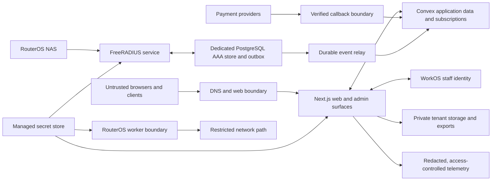

# MylesNet Phase 0 threat model

**Task:** MN-PLAN-006 · **Plan phase:** Phase 0 — close planning and turn decisions into build contracts 
**Status:** Initial planning threat model; risks and controls require owner review and evidence. 
**Scope:** V1 public/signup, platform, tenant, subscriber/captive, application backend, payments, RADIUS/AAA, router worker, files/exports, identity, support, and operational telemetry.

This document organizes threats and approved mitigations. It is not a completed security assessment, penetration test, legal review, or claim that any control is implemented. Risk priorities are planning priorities, not a quantitative risk acceptance. A security owner and service owners remain to be named.

## Security objectives

1. A tenant, branch, or subscriber can access only records and actions within current verified identity, role, permission, lifecycle, and resource scope.
2. Financial effects are attributable, currency-correct, immutable, idempotent, and reconciled to provider evidence.
3. RADIUS authentication/accounting remains isolated from browser and Convex availability; outage behavior never fails open.
4. Support, platform administration, exports, secret operations, and network changes are narrowly scoped, time-limited where appropriate, MFA-protected, and auditable.
5. Private data, credentials, reference captures, and telemetry do not leak through logs, public caches, generated files, repository history, or local-to-production configuration.
6. Recovery and deletion preserve tenant boundaries, legal holds, and mandatory financial/security history.

## Trust boundaries and assets

The diagram is a boundary model, not a deployment topology. Trust must be established at each server/worker boundary; no arrow implies shared credentials or unrestricted network access.

### Protected assets

- Staff and subscriber identities, MFA/recovery, tenant membership, roles, permissions, branch scope, support grants, and audit history.
- Subscriber contact, service, access credentials, consent, and location/network metadata.
- Tenant and platform ledger entries, provider transaction references, invoice data, payment tokens, merchant account references, and payout destinations.
- RADIUS secrets, router bootstrap material, NAS mappings, AAA policy/accounting events, active sessions, and worker commands.
- Tenant domain ownership proofs, TLS state, files, exports, branding assets, and private reference captures.
- Provider/WorkOS/storage/deployment secrets, application keys, backups, traces/logs, and incident evidence.

## Adversaries and failure sources

- Unauthenticated internet users, bots, or attackers exploiting public endpoints, callbacks, signup, domain resolution, or captive portals.
- A malicious or compromised staff/subscriber identity attempting cross-tenant access, privilege escalation, export, or network/financial actions.
- A tenant admin or Owner making mistakes, misconfiguring scope, uploading unsafe files, or attempting to misuse delegated access.
- A platform operator or support agent exceeding an approved grant or exporting/revealing tenant data.
- Forged, duplicated, delayed, reordered, or mismatched provider/NAS/router events; compromised integrations or stale credentials.
- Service, queue, database, identity, DNS, provider, or network outages; retries, stale caches, restores, and operator errors.
- Accidental use or disclosure of real account data contained in private reference screenshots or logs.

## Threat register

| ID / planning priority | Threat and attack path | Required controls and accepted boundaries | Residual evidence / accountable owner |
|---|---|---|---|
| `THR-001` High | Tenant escape through missing tenant predicate, branch ambiguity, unscoped job/file/search/export/cache, or live subscription. | Server-resolved `tenantId` on every tenant resource; explicit branch semantics; tenant-first bounded queries; reauthorize subscription updates; clear caches on switch/revoke. See ADR-0003 and `IC-DATA-01`. | MN-DEC-016 remains open. Need resource-to-branch map, cache/index review, cross-tenant and branch negative acceptance across every data path. Application security owner unassigned. |
| `THR-002` High | Privilege escalation via self-assignment, Admin delegation beyond ceiling, custom-role inheritance, owner duplication, or missing MFA step-up. | Fixed single Owner, no self-escalation, role ceiling, Owner-controlled high-risk grants, independent permission sets, MFA step-up and server-side checks. See `REQ-TEN-10`, `REQ-IAM-01/02`, ADR-0002/0003. | WorkOS MFA compatibility, every permission/action matrix, recovery and role-change acceptance. Identity/security owner unassigned. |
| `THR-003` High | Stale WorkOS session, membership removal, branch/role change, or tenant suspension leaves old data in a live feed/cache. | Re-evaluate current app membership/tenant state for every operation and live delivery; immediately stop subscriptions and clear disallowed state. WorkOS membership alone is not authorization. | Define revocation mechanism, stream close bound, cross-app cookies and cache behavior; verify `SEQ-IAM-01`. Owner unassigned. |
| `THR-004` High | Forged/replayed/duplicate payment callback, wrong merchant/tenant, amount/currency mismatch, or race creates a duplicate or incorrect ledger/activation effect. | Verify signature/replay/schema; durably store raw event separately; resolve provider mapping and intent; validate amount/currency before ledger posting; idempotency; exception queue; immutable reversals and reconciliation. See ADR-0006 and `IC-PAY-01`. | Provider-specific key rotation/replay windows, concurrent processing, late settlement/refunds and one-effect/one-activation evidence. Payments owner unassigned. |
| `THR-005` High | Payment token, credential, or merchant secret is returned to browser, log, support session, or export. | Provider-hosted/tokenized checkout; secret references only; write/rotate-only credentials; field masking; redacted logs; support grant explicitly excludes payment secrets. | Inspect every API/error/log/export field and provider contract; storage/key management remains open. Security/payments owners unassigned. |
| `THR-006` High | RADIUS outage or Convex/WAN outage causes authentication fail-open, lost acknowledged accounting, stale policy use, or duplicate session projection. | FreeRADIUS + dedicated PostgreSQL AAA path independent of Convex; reject new logins on RADIUS outage, preserve current sessions where possible; persist accounting/outbox before ack; stable NAS/session/event dedupe; bounded retry and reconciliation. | Define PostgreSQL HA, queue capacity, policy propagation/staleness, recovery drain, out-of-order cases, and proof. Network owner unassigned. |
| `THR-007` High | Router compromise or worker credential leakage exposes WinBox, SSH, RouterOS API, or broad tenant network reachability. | RouterOS 7 least-privilege tunnel permits RADIUS and CoA/Disconnect only; never expose router-admin ports through it; scoped credentials, allowlist, single-use/expiring provisioning, rotation/revocation, and isolated lab. | Exact device/lab inventory, CGNAT/firewall, bootstrap and separate command transport remain open; no real router connection in planning. Network owner unassigned. |
| `THR-008` High | Platform support session becomes tenant impersonation, persists beyond expiry, reads outside grant, mutates sensitive data, or performs export. | Owner-approved tenant/resource scope, reason/case, visible banner, maximum one hour; narrowly enumerated write exceptions; two distinct emergency approvers, read-only emergency access and notice; all actions audited; no export. | Test expiry, revocation, nested scope, emergency identity separation, masking and non-export paths. Support/security owners unassigned. |
| `THR-009` High | Domain/Host header confusion maps an attacker-controlled or stale hostname to another tenant or leaks private cached page/theme. | Verified unique tenant-host mapping; explicit DNS proof; unknown/suspended host fails closed; hostname is routing context only; private cache keys include server-resolved scope; old host remains only for same tenant during migration. | DNS normalization, rebinding, certificate renewal/revocation, callback inventory and cache isolation need security review. Domain owner unassigned. |
| `THR-010` High | Secrets, PII, subscriber credentials, message bodies, or recovery evidence leak through errors, traces, telemetry, support, or backups. | Safe errors/correlation IDs; redacted telemetry; restricted audit/incident access; no secrets in browser response; encrypted backups and secret manager. | Define scrub rules, retention, access review, restore scope and alert policy. Security/operations owners unassigned. |
| `THR-011` High | Private screenshot/reference material exposes live third-party account data through Git, issue text, generated catalog, OCR, filenames, or metadata. | Keep private reference assets local-only; include only sanitized route/view descriptors and necessary workflow observations; no image contents, OCR, filenames, or metadata in public artifacts. | Repo history/secrets scan and catalog audit evidence; reference owner unassigned. |
| `THR-012` High | Incorrect deletion or restore erases required financial/audit proof, resurrects deleted PII, ignores a legal hold, or crosses tenant boundaries. | Category schedule and legal hold; distinct offboarding/deletion flow; append-only financial/audit facts; encrypted isolated restore; deletion coverage across primary data, files, caches, indexes, analytics, logs, backups. | Exact periods, backup expiry, RPO/RTO, restore drill, controller/processor decisions and named owners remain open. Legal/data/operations owners unassigned. |
| `THR-013` Medium/High | Queue, webhook, report, campaign, or router job flood starves authentication, payment integrity, or authorized live views. | Per-tenant fairness, bounded query/report windows, concurrency and batch budgets, retry caps/backpressure, priority and visible `RATE_LIMITED`/`QUOTA_EXCEEDED` states; do not silently drop. | Workload sizes, numeric limits, largest tenant/burst profile, queue budgets and alerts remain to be measured. Service owners unassigned. |
| `THR-014` Medium/High | Local, preview, or shared development environment accidentally uses production credentials/data or sends real payment/SMS/network actions. | Synthetic-only local data; separate deployments, callbacks, domains, secrets and provider sandbox credentials; no production URLs/keys in local defaults; mock providers and test-only network. | Environment inventory, secret scan, redaction and deployment guard evidence belongs to Phase 1. Platform/security owner unassigned. |

## Abuse and failure scenarios for acceptance design

Before implementation, turn each high-priority threat into positive/negative and recovery acceptance cases. At minimum cover: tenant and branch ID substitution; revoked membership during an active subscription; self-escalation and delegated high-risk grants; replayed/mismatched payment callback; payment event during provider or Convex outage; duplicate/out-of-order RADIUS accounting; RADIUS/PostgreSQL loss; unauthorized router tunnel port; support grant expiry and attempted export; unknown host and stale domain cache; secret-bearing exception/log; reference asset accidentally staged; deletion under legal hold; restore with mixed-tenant data; and noisy-neighbor queue saturation.

## Risk ownership and review

No security or operations owner has been assigned by the source documents. MN-PLAN-008 must assign threat owner, mitigation owner, acceptance evidence owner, residual-risk authority, and review date for each High item. Revisit this model when the product boundary, data inventory, provider flow, threat evidence, regional plan, or legal basis changes.

## Related artifacts

- [Data ownership and classification](DATA-OWNERSHIP-AND-CLASSIFICATION.md)
- [API/error/event contract backlog](API-ERROR-EVENT-CONTRACT-BACKLOG.md)
- [Synthetic-data and environment rules](SYNTHETIC-DATA-AND-TEST-ENVIRONMENTS.md)
- [Requirement/data/threat crosswalk](REQUIREMENT-ROUTE-TRACEABILITY.md#cross-cutting-data-event-and-threat-contracts)
- [ADR and interface contracts](adr/README.md)
