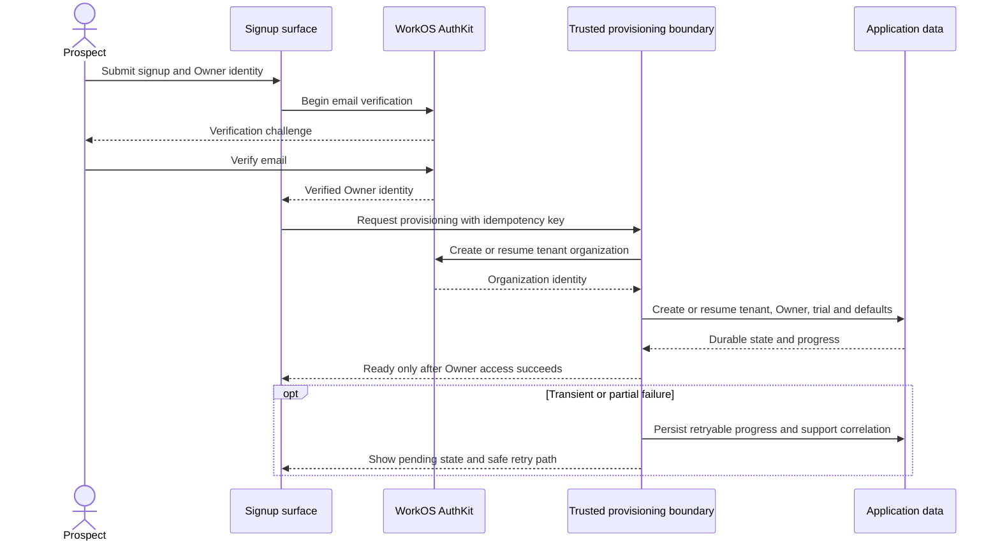
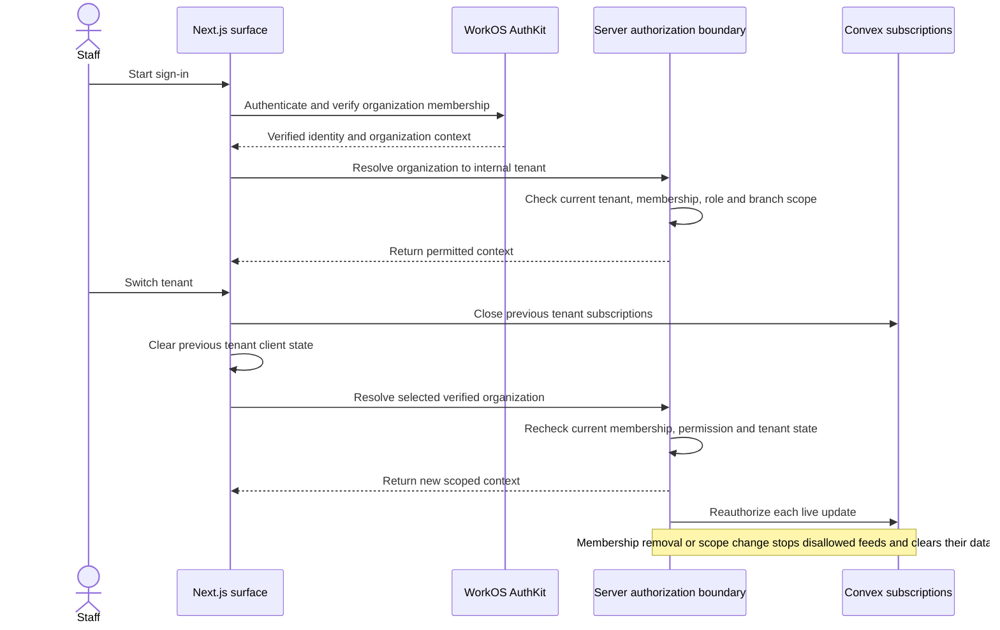
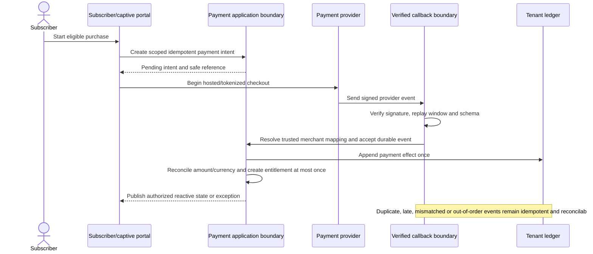
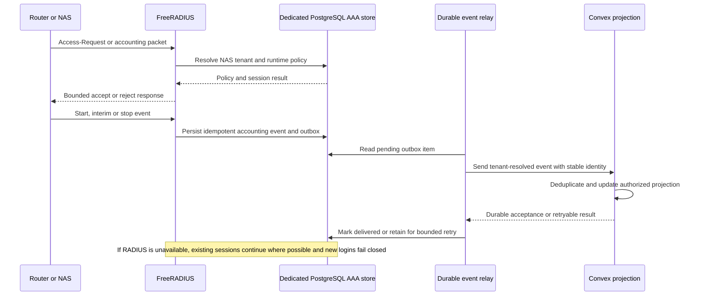
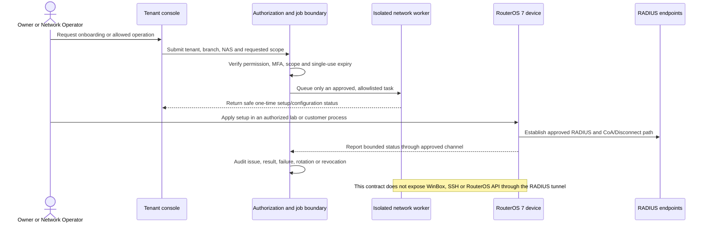
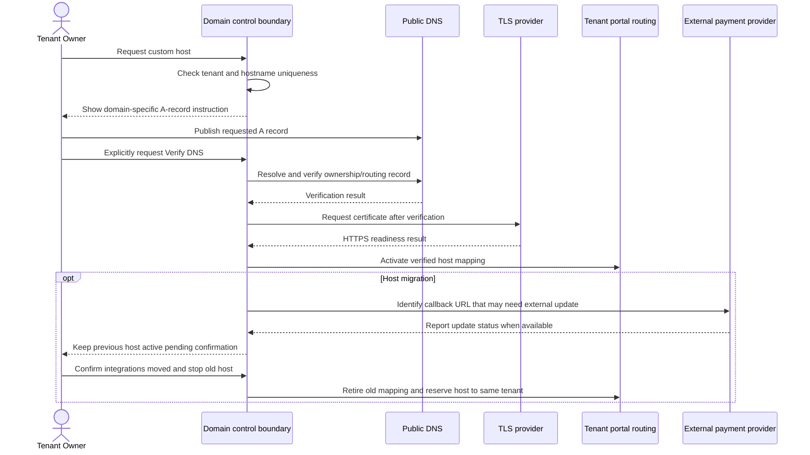
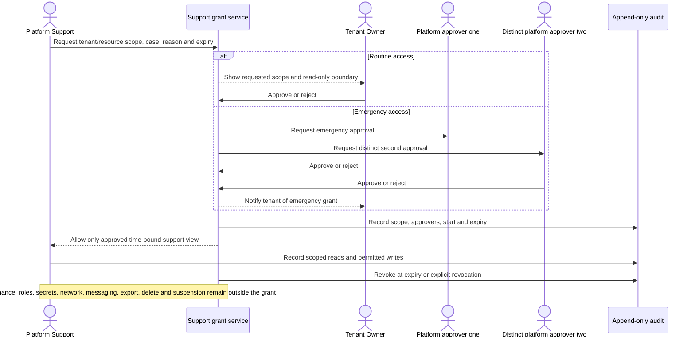
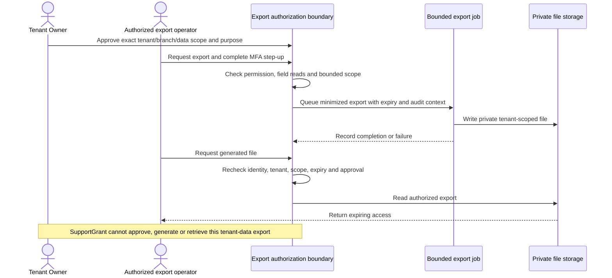
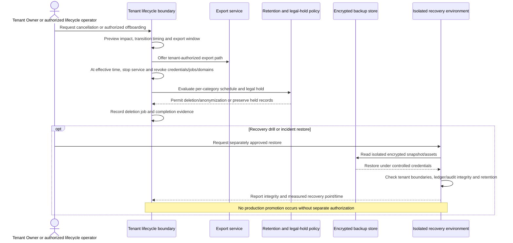

# Architecture interface and sequence contracts

**Task:** MN-PLAN-005 · **Plan phase:** Phase 0 — close planning and turn decisions into build contracts
**Status:** Planning-level trust, ownership, and sequence contracts; no implementation is authorized.

These contracts connect the approved architecture boundaries to requirement IDs. They are not runtime API schemas, provider contracts, network configurations, or evidence that an integration is live. Before implementation, define concrete schemas, limits, error codes, versioning, owners, and acceptance automation under MN-PLAN-006 and the relevant later phase.

## Interface contract registry

| Contract | Boundary and required behavior | Related requirements / sequences |
|---|---|---|
| `IC-APP-01` | Surface ownership: `apps/web` public/subscriber, `apps/admin` platform/tenant operations, `apps/storybook` design review; server/client and cache boundaries are explicit. Hostname is routing context only. | `REQ-PUB-*`, `REQ-SIGNUP-01`, `REQ-PLAT-*`, `REQ-TEN-*`, `REQ-SUB-*`, `REQ-CAP-*`; `SEQ-SIGNUP-01`, `SEQ-IAM-01` |
| `IC-IAM-01` | A verified WorkOS staff identity and organization are resolved server-side to the internal tenant; WorkOS membership is not application permission. Subscriber identity stays separate. | `REQ-SIGNUP-01`, `REQ-PLAT-04`, `REQ-TEN-10`, `REQ-IAM-01/02`; `SEQ-SIGNUP-01`, `SEQ-IAM-01/02` |
| `IC-IAM-02` | Current tenant status, membership, role, permission, branch/resource scope and MFA step-up are checked at each operation; membership removal and permission/scope changes immediately stop access and stale feeds. | `REQ-PLAT-04`, `REQ-PLAT-05`, `REQ-TEN-02/05/09/10/11`, `REQ-IAM-01/02`; `SEQ-IAM-01/02`, `SEQ-SUPPORT-01` |
| `IC-DATA-01` | Every tenant-owned row, file, event, export, cache key, search document, job and subscription carries server-derived tenant scope; optional branch semantics are explicit; never trust client tenant/branch IDs. | All `REQ-TEN-*`, `REQ-SUB-*`, `REQ-CAP-*`, `REQ-NET-*`; `SEQ-IAM-01`, `SEQ-PAY-01`, `SEQ-RADIUS-01`, `SEQ-EXPORT-01` |
| `IC-RADIUS-01` | FreeRADIUS uses the dedicated PostgreSQL AAA runtime store; Convex is off the packet path. Durable accounting/outbox events are tenant-resolved, idempotent, retried and reconcilable; outage policy remains fail-closed for new logins. | `REQ-NET-01`, `REQ-TEN-05`; `SEQ-RADIUS-01` |
| `IC-ROUTER-01` | A separately credentialed RouterOS 7 worker accepts only authorized, allowlisted jobs; tunnel allows RADIUS and CoA/Disconnect only, with timeout, result, audit, rotation and revocation. | `REQ-NET-02`, `REQ-TEN-05/11`; `SEQ-ROUTER-01` |
| `IC-PAY-01` | Signed, replay-checked provider event maps through trusted merchant/provider configuration; durable idempotent processing creates one payment effect and at most one service activation. Browser redirect is not settlement authority. | `REQ-PLAT-03`, `REQ-TEN-07/08/12`, `REQ-SUB-02`, `REQ-CAP-01`; `SEQ-PAY-01`, `SEQ-PLAN-01` |
| `IC-LEDGER-01` | Platform subscriptions and tenant subscriber collections use separate ledgers/merchant accounts; settled facts are append-only, currencies are exact, and correction is a linked reversal. Country pooled collection remains disabled until approved. | `REQ-PLAT-03`, `REQ-TEN-07/08/12`, `REQ-SUB-02`, `REQ-CAP-01`; `SEQ-PAY-01`, `SEQ-PLAN-01` |
| `IC-DOMAIN-01` | A tenant host maps only after explicit ownership verification and DNS/TLS readiness; old hosts remain until Owner confirms callback migration and stop-serving; host never grants identity access. | `REQ-TEN-11`, `REQ-PUB-05`; `SEQ-DOMAIN-01` |
| `IC-THEME-01` | One DTCG source generates semantic mappings; validated tenant brand inputs cannot override security/status/focus/layout tokens; theme is presentation context, not authorization. | `REQ-TEN-01/11`, all public and portal surfaces; source gaps in MN-DEC-021 |
| `IC-STORAGE-01` | Tenant objects are private, scoped and lifecycle-tracked; file storage provider remains undecided pending region, size, lifecycle, cost and recovery evidence. | `REQ-TEN-09/11/13`, `REQ-PLAT-02/05/07`; `SEQ-EXPORT-01`, `SEQ-OFFBOARD-01`, `SEQ-RESTORE-01` |
| `IC-EXPORT-01` | Exports have explicit actor/Owner approval, permission, tenant/branch/data scope, MFA, purpose, minimization, expiry, reauthorization and audit. A support grant never authorizes tenant-data export. | `REQ-PLAT-02/05/07`, `REQ-TEN-09/13`; catalog `AC-X-01/02/03`; `SEQ-EXPORT-01` |
| `IC-RECOVERY-01` | Backups/restores preserve tenant boundaries, append-only financial/audit history, country retention and legal holds; RPO/RTO, frequency, retention and owner remain open. | `REQ-PLAT-02/03/07`, `REQ-TEN-12/13`; `SEQ-OFFBOARD-01`, `SEQ-RESTORE-01` |
| `IC-DEPLOY-01` | Separate local synthetic, development, sandbox/integration, staging and production identities, secrets, callbacks, domains, queues and data. Service credentials and deploy targets are explicit per environment. | Cross-cutting; `SEQ-RESTORE-01` and later environment contract |
| `IC-MIGRATION-01` | Schema/data changes are forward/backward compatible, tenant-checkpointed, idempotent, observable and compensable; financial history is corrected with reversals, not destructive rollback. | `REQ-PLAT-03`, `REQ-TEN-12/13`; `SEQ-PLAN-01`, `SEQ-OFFBOARD-01` |
| `IC-EVENT-01` | Events have trusted source/tenant mapping, stable identity, schema/version, idempotency, bounded retry/backpressure, durable result, and reconciliation/dead-letter ownership. Exact envelope remains MN-PLAN-006. | `REQ-PLAT-01/06`, `REQ-TEN-01/05/07/08`, `REQ-CAP-01`, `REQ-NET-01`; `SEQ-PAY-01`, `SEQ-RADIUS-01` |
| `IC-OBS-01` | Correlation crosses trusted service boundaries while logs/metrics are redacted, access-controlled, bounded, and explicit about source timestamps and tenant scope. Targets are measured only after source/exclusion definitions are approved. | `REQ-PLAT-01/06`, `REQ-TEN-01/13`, `REQ-NET-01/02`; all sequences below |
| `IC-INCIDENT-01` | Incidents have service owner, severity, response/on-call route, impact assessment, tenant-safe communications, update cadence, recovery evidence, and post-incident record. | Operational contract; referenced by all high-risk sequences |

## Sequence registry

| Sequence | Contract outline | Related journeys / acceptance |
|---|---|---|
| `SEQ-SIGNUP-01` | Verified email → idempotent WorkOS organization/internal tenant/Owner provisioning → initialized trial/settings → ready only after Owner access succeeds; bounded retry preserves progress and offers support correlation. | `REQ-SIGNUP-01`, `AC-SIGNUP-01` |
| `SEQ-IAM-01` | Staff signs in through WorkOS → server resolves organization to tenant → checks current tenant/member/role/scope → returns permitted context; switching clears old tenant state first. Revocation or scope change closes feeds and clears disallowed data. | `REQ-PLAT-04`, `REQ-TEN-10`, `AC-PLAT-04`, `AC-TEN-10` |
| `SEQ-IAM-02` | Owner transfer or recovery follows `J-IAM-01/02`, including verification, MFA, current/trusted contacts, cooling-off/independent approval where specified, immediate access recomputation, notification and audit. No support grant is implied. | `REQ-IAM-01/02`, `AC-IAM-01/02` |
| `SEQ-PAY-01` | Create scoped idempotent intent → provider checkout → verify signed/replay-safe event → resolve merchant and tenant server-side → append payment once → reconcile → activate once or show an exception; retries preserve immutable evidence. | `J-SUB-02`, `J-CAP-01`, `AC-SUB-02`, `AC-CAP-01`, `REQ-PLAT-03` |
| `SEQ-PLAN-01` | Owner confirms plan action with required MFA → exact billing legal entity/currency and entitlement version are checked → invoice/ledger effect is recorded → effective transition applies with notice and quota behavior; downgrade never silently removes existing accounts/services. | `REQ-PLAT-03`, `REQ-TEN-12`, `AC-PLAT-03`, `AC-TEN-12` |
| `SEQ-RADIUS-01` | NAS maps to tenant through trusted registration → FreeRADIUS checks dedicated PostgreSQL AAA policy → durably stores accounting/outbox event → relay submits tenant-resolved idempotent projection to Convex → recovery drains/reconciles; new logins fail closed on RADIUS loss. | `J-NET-01`, `REQ-NET-01`, `AC-NET-01` |
| `SEQ-ROUTER-01` | Authorized Owner/Network Operator previews request → single-use/expiring setup or allowlisted job runs through isolated worker → worker records result/timeout and audit → secret/config is revoked or rotated as required. Lab-only until authorized. | `J-NET-02`, `REQ-NET-02`, `AC-NET-02` |
| `SEQ-DOMAIN-01` | Owner requests host → system checks uniqueness and issues DNS proof → Owner explicitly verifies A record → TLS becomes ready → verified mapping activates → old host stays active through callback migration → Owner explicitly stops old host, which remains reserved. | `REQ-TEN-11`, `AC-TEN-11` |
| `SEQ-SUPPORT-01` | Support requests tenant/resource/reason/case/expiry → Owner approves, or emergency path uses two distinct approvers → time-bound visible grant begins → each access is scoped/audited → expiry/revocation closes access and tenant is notified per policy. Export stays prohibited. | `REQ-PLAT-05`, `AC-PLAT-05`, `AC-X-02/03` |
| `SEQ-EXPORT-01` | Authorized tenant Owner approves exact scope → caller passes permission/MFA/read-scope checks → bounded job minimizes fields → expiring file is generated → each retrieval rechecks user/tenant/scope → expiry/revoke and audit are recorded. SupportGrant is absent. | Cross-cutting `AC-X-01/02/03`; `REQ-TEN-09`, `REQ-PLAT-02/07` |
| `SEQ-OFFBOARD-01` | Authorized cancellation/offboarding → impact/notice/export window → service state transition and credential/domain/job revocation → category retention/legal-hold evaluation → deletion/anonymization job and evidence; export and deletion remain separate. | `AC-D-03`, `REQ-PLAT-02`, `REQ-TEN-12/13` |
| `SEQ-RESTORE-01` | Isolated restore request with role/incident approval → restore encrypted snapshot/assets under controlled credentials → validate tenant isolation, retention/legal holds and ledger/audit integrity → record RPO/RTO/data integrity → only separately authorized service recovery may promote restored service. | `IC-RECOVERY-01`; technical-specification §14.8 |

These outlines are planning contracts. Detailed failure states, payload schemas, retry limits, provider-specific behavior, operational ownership, and acceptance automation remain Phase 0/implementation work. In particular, router lab proof, support-grant workflow, plan downgrade, tenant offboarding, and restore drill remain unperformed.

## Sequence diagrams

These diagrams make the service handoffs and trust boundaries explicit. They intentionally omit concrete API payloads, provider configuration, and implementation details that remain open.

### `SEQ-SIGNUP-01` — verified signup and idempotent provisioning



### `SEQ-IAM-01` — staff sign-in, tenant switching, and revocation



### `SEQ-IAM-02` — ownership transfer and recovery

```mermaid
sequenceDiagram
  actor Current as Current Owner or claimant
  participant Surface as Tenant/ recovery surface
  participant App as Identity and ownership service
  participant Incoming as Incoming Owner
  participant Support as Trained Support
  participant Security as Distinct Security Admin
  participant Contacts as Previously verified contacts
  Current->>Surface: Request ownership transfer or recovery
  Surface->>App: Verify identity, tenant and allowed path
  opt Normal owner transfer
    App-->>Incoming: Require verified invitation and acceptance
    Incoming->>App: Accept and complete MFA step-up
    App->>App: Atomically change Owner and former-Owner access
  end
  opt All verified methods are lost
    App->>Support: Open minimized recovery case
    Support->>App: Verify current business and claimant authority
    Support->>Contacts: Call an existing trusted contact
    App->>App: Apply cooling-off and prior-contact notices
    opt No trusted contact or high-risk case
      Support->>Security: Request distinct MFA-protected approval and required evidence review
      Security->>App: Approve or reject with reason
    end
    App->>App: Record decision and dispute path; grant no routine tenant-data access
  end
  App-->>Contacts: Notify verified contacts of request and decision
```

### `SEQ-PAY-01` — payment settlement and one-time activation



### `SEQ-PLAN-01` — upgrade or scheduled downgrade

```mermaid
sequenceDiagram
  actor Owner as Tenant Owner
  participant App as Subscription boundary
  participant Provider as MylesNet billing provider
  participant Ledger as Platform ledger
  Owner->>App: Request plan change and confirm with MFA
  App->>App: Resolve selected billing entity and exact invoice currency
  alt Upgrade
    App->>Provider: Request prorated payment
    Provider-->>App: Verified payment result
    App->>Ledger: Append invoice and payment effects
    App->>App: Apply upgraded entitlement after payment
  else Downgrade
    App->>Ledger: Record requested next-renewal change
    App->>Owner: Confirm effective date and quota impact
    App->>App: Preserve current services until effective boundary
  end
  Note over App,Ledger: No cross-entity conversion; existing accounts/services are not silently deleted at quota
```

### `SEQ-RADIUS-01` — authentication and accounting outbox



### `SEQ-ROUTER-01` — least-privilege router onboarding/command boundary



The exact worker-to-device command transport remains open. If an operation requires router-admin access, it stays disabled until a separately approved, least-privilege path and lab evidence exist.

### `SEQ-DOMAIN-01` — DNS verification, TLS readiness, and migration



### `SEQ-SUPPORT-01` — scoped support grant



### `SEQ-EXPORT-01` — Owner-authorized tenant export



### `SEQ-OFFBOARD-01` and `SEQ-RESTORE-01` — offboarding and isolated restore



The 30-day post-cancellation export window is approved. Category retention periods, backup expiry, RPO/RTO, restore frequency, and recovery ownership remain open and must be supplied before production readiness.
